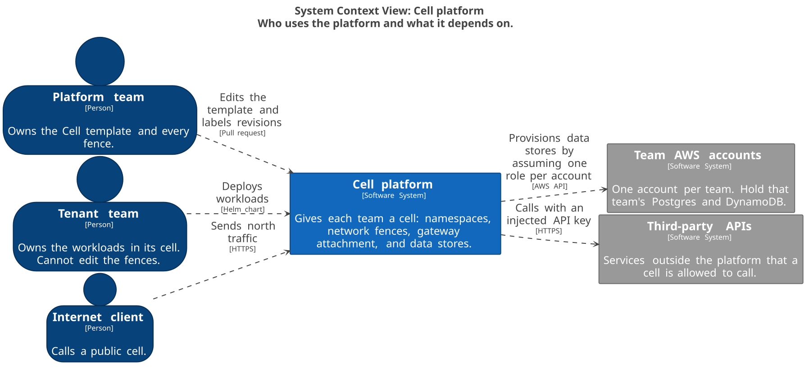
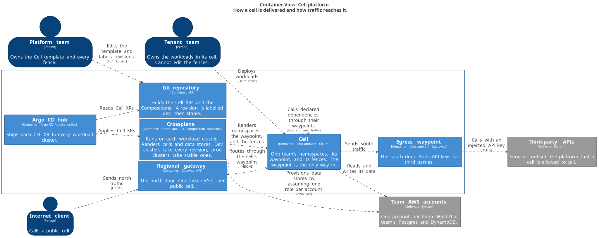
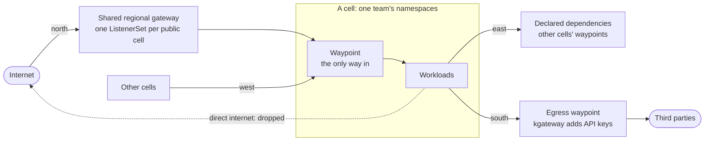

# Cell platform prototype

> **Bottom line.** To give every team its own *cell* on a shared Kubernetes platform, use **Crossplane alone**, delivered by the Argo CD hub you already run. A platform template change then reaches every cell with no tenant pull request, dev first and prod after a soak. Each of a cell's four traffic directions gets a fence that tenants cannot delete. Kratix, Radius, and OpenChoreo were tested beside Crossplane and rejected for this job.

Three facts back that up:

- **It was run, not read.** Seven test rounds on local clusters (kind, k3d, and the [floci](https://floci.io/) AWS emulator), in November 2026. Every fence was also tested with the fence removed, to prove the fence is what blocks the traffic.
- **It is reproducible.** Every manifest, script, and raw output is in [prototype/](prototype/). Every claim from documentation links to a verbatim capture in [sources/raw/](sources/raw/).
- **It found a real bug.** The Crossplane AWS provider sent role-assumption calls to real AWS during an emulator test. The bug report and the fix are filed upstream ([issue #2328](https://github.com/crossplane-contrib/provider-upjet-aws/issues/2328), [PR #2329](https://github.com/crossplane-contrib/provider-upjet-aws/pull/2329)).

Read the one-page [decision memo](docs/decision-memo.md) next. The full argument is in [docs/recommendation.md](docs/recommendation.md), and every test is in [docs/prototype-results.md](docs/prototype-results.md).

## The problem this solves

A cell is one team's slice of the platform: its namespaces, its network fences, its gateway attachment, and its data stores in the team's own cloud account.

On a platform shaped like the New York Times' DVSP, the contract with each service is one versioned Helm chart. A platform change reaches a running service only when that team merges a chart bump, so a platform-wide migration waits on every tenant. This repo asks which tool should own the cell so that the platform team can change all cells at once, in a staged order, and without a tenant being able to weaken its own fences.

This is an outside assessment of NYT's published setup, not NYT's plan.

## How a cell change reaches every cluster

The platform team edits one Composition in Git. Argo CD ships each `Cell` to every workload cluster, and the Crossplane on that cluster renders it. Dev cells take every new revision. Prod cells take only the revisions labelled `stable`.

Both C4 diagrams on this page are generated from one model, [docs/architecture/workspace.dsl](docs/architecture/workspace.dsl).

In the test, a Composition labelled `dev` moved only the dev cluster. Relabelled `stable`, it then moved prod. A deleted fence object was recreated by the local Crossplane in about 10 seconds.

## How a cell is fenced

Every direction has a path that traffic is meant to take and a fence that drops traffic that skips the path. The platform owns every fence, in a place where tenants have no write access.

| Direction | Fence | What the test showed |
| --- | --- | --- |
| North, internet to cell | The platform allocates hostnames (Gatekeeper) | A duplicate hostname got `HostnameConflict` |
| West, cells to cell | A ztunnel policy that admits only the cell's waypoint | Without the policy, three bypasses returned 200 |
| East, cell to cells | A cluster-scoped Cilium allow-list built from declared dependencies | A namespace admin could not delete the allow-list |
| South, cell to third parties | An Admin-tier ClusterNetworkPolicy that denies direct internet egress | The deny held after the tenant deleted its own policy |

## Why Crossplane, and not the others

Crossplane 2.4.2 and Kratix were tested on the same clusters. Both push a template change to every tenant with no tenant pull request. Crossplane won on staging and on safety.

| Check | Kratix | Crossplane |
| --- | --- | --- |
| Staged rollout in open source | No. Paid SKE, or a script you write | Yes. Revision `channel` labels |
| Template edit without a version bump | Re-ran every request within 1 second, pinned or not | A new immutable revision per edit. Pins held |
| Releases | Rolling `latest`, not CNCF | Semver releases, CNCF graduated |

- **Radius:** a Recipe Pack change reaches only later deployments, so a redeploy trigger remains. Admission control never saw writes to the Radius API in the test.
- **OpenChoreo:** it replaces the scaffolder, the chart, and the Tenant Operator at once. An external Argo CD fought its `autoDeploy` every 5 minutes until told to ignore one field.
- **Mutating admission:** it fires only on create and update, and it creates nothing, so it cannot carry a platform-wide change.

The [decision memo](docs/decision-memo.md) lists the risks and the four decisions that only a platform owner can make.

## Reproduce the tests

You need Docker, `kind`, `k3d`, `kubectl`, `helm`, `gh`, the AWS CLI, and Go. Every test runs on one machine:

- kind with Cilium 1.20.4 and Istio 1.32.0 ambient.
- k3d for OpenChoreo v1.3.3, and as a second workload cluster.
- floci as the AWS emulator.

Follow the order in [prototype/README.md](prototype/README.md). Two rules cost time when skipped:

- **Before any Crossplane AWS test against an emulator, fence the provider's egress** with `prototype/kind/provider-egress-fence.yaml`. provider-aws-rds v2.8.1 sent role-assumption STS calls to real AWS until the endpoint was overridden.
- **For any trust-policy test, turn on floci IAM enforcement** with `FLOCI_SERVICES_IAM_ENFORCEMENT_ENABLED=true`. Without enforcement, an untrusted account can assume any role.

Round 6 uses only public, Apache-2.0 Terraform modules (Cloud Posse `terraform-aws-dynamodb` and `terraform-aws-modules/rds`). Both are referenced, not vendored.

## Upstream contributions

- **Bug:** [crossplane-contrib/provider-upjet-aws#2328](https://github.com/crossplane-contrib/provider-upjet-aws/issues/2328). `assumeRoleChain` and WebIdentity STS calls ignore `spec.endpoint` and go to the public STS endpoint.
- **Fix:** [crossplane-contrib/provider-upjet-aws#2329](https://github.com/crossplane-contrib/provider-upjet-aws/pull/2329), from branch `fix-assume-role-chain-endpoint` of [allensanborn/provider-upjet-aws](https://github.com/allensanborn/provider-upjet-aws). The fix installs the endpoint resolver before the role chain is built, carries the resolver into each link, and applies it on the WebIdentity path. It adds `internal/clients/role_chain_endpoint_test.go`.
- **Workaround until the fix ships:** set `AWS_ENDPOINT_URL_STS` on the provider pod with a DeploymentRuntimeConfig (`prototype/kind/provider-sts-endpoint.yaml`).

## Layout

| Path | What |
| --- | --- |
| [docs/decision-memo.md](docs/decision-memo.md) | One page: problem, decision, evidence, fences, rejected options, risks |
| [docs/recommendation.md](docs/recommendation.md) | The full decision, the adoption path, and the owner decisions |
| [docs/prototype-results.md](docs/prototype-results.md) | Results of the seven test rounds, with negative controls |
| [docs/](docs/) | The comparisons behind the decision: Kratix, Radius, OpenChoreo, Crossplane, and the traffic tooling for each direction |
| [docs/sources/](docs/sources/) | Summaries of the primary sources: project docs, code, and GitHub issues |
| [sources/raw/](sources/raw/) | Verbatim captures of those sources, each with `resource`, `fetched`, and `fetch_note` provenance |
| [prototype/](prototype/) | Manifests and scripts for every test. [prototype/README.md](prototype/README.md) gives the order |
| [upstream/](upstream/) | Text of the bug report and of the fix PR |

## Limits

Nothing here ran at production scale or against real AWS. Primary sources were captured 2026-11-13 to 2026-11-17, and each capture's header pins the versions. Claims that were not confirmed are marked **UNVERIFIED**, and inferences are labelled.

## Contributing and security

See [CONTRIBUTING.md](CONTRIBUTING.md) to propose a change and [SECURITY.md](SECURITY.md) to report a vulnerability. The project is licensed under [Apache-2.0](LICENSE). [docs/openssf-baseline.md](docs/openssf-baseline.md) records how it meets the OpenSSF Baseline.
