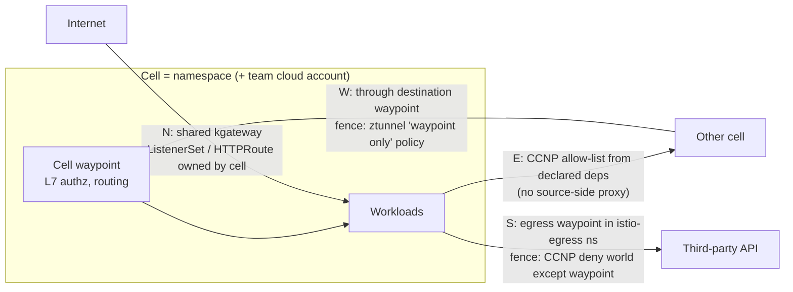

# Cell traffic on Kubernetes: north, south, west and east

Written 2026-11-13 in answer to: *dig deeper into the options around network traffic to the cell. The traffic directions and configuration could probably be implemented using a variety of tools*. Builds on [openchoreo-cells-radius-crossplane](openchoreo-cells-radius-crossplane.md). Evidence: [project docs captured 2026-11-13](sources/cell-traffic-docs-2026-11.md) (Gateway API v1.7.0, network-policy-api v0.3.0, Cilium v1.20.4, Istio 1.32.0, OpenChoreo v1.3.3) and the WSO2 cell paper. The stack assumed is [NYT DVSP](sources/nytimes-dvsp-developer-platform.md)'s: Cilium, Istio ambient, a shared regional ingress moving to kgateway, Argo CD, Gatekeeper. Recommendations are this page's assessment. Nothing was run for the original analysis; the mapping was later tested on kind ([prototype-results](prototype-results.md)).

## What the paper actually asks for

The four directions, in the paper's words: **northbound**, external APIs consumed by channels; **southbound**, calls to third-party APIs outside the enterprise; **westbound**, internal APIs consumed by another cell; **eastbound**, calls from the cell to another cell. The gateway "becomes the only access point (endpoint) for the cell", a policy enforcement point and observability touchpoint.

**It does not require a gateway per cell.** "Cell-based architecture prefers a unique gateway… per cell. However, using a shared gateway using a federated or centralized deployment pattern is acceptable." Its minimum security bar is gateways "which enable policies that control which other cells can call it", with "end-to-end federated security with identities based on tokens and certificates" recommended. **Correction:** an earlier version of [openchoreo-cells-radius-crossplane](openchoreo-cells-radius-crossplane.md) said the paper *forces* per-cell gateways and that NYT's central ingress diverges from it. The paper's own text allows NYT's design.

## The refinement: every direction needs a path and a fence

The user's hypothesis holds: each direction can be carried by two or three different tools. But the tools split into two kinds, and a direction is only implemented when it has both:

- **Path:** a proxy that traffic actually traverses and that applies L7 policy. Examples: a Gateway, a waypoint, an egress gateway.
- **Fence:** a policy that drops traffic that skipped the path. Examples: NetworkPolicy, ClusterNetworkPolicy, CiliumClusterwideNetworkPolicy, a ztunnel L4 AuthorizationPolicy.

Every gateway doc says this about itself. Istio's sidecar egress doc: "Istio *cannot securely enforce* that all egress traffic actually flows through the egress gateways… Mechanisms external to Istio must enforce this requirement." The ambient doc: the `istio.io/use-waypoint` label "does not guarantee" traversal, and ztunnel routes directly when the waypoint is unavailable.

**Tenant-proof means the fence lives where tenants can't write it**, in a cluster-scoped or root-namespace object. Allow rules are never a ceiling, because a tenant's own allow adds to the platform's. Only **deny rules or tiered policy** constrain tenants.

## Northbound: external clients into the cell

- **Path:** a Gateway API Gateway (kgateway, Envoy Gateway, Istio or Cilium).
- **Delegation:** the platform owns the Gateway, and each cell owns its routes. "The Gateway owner must explicitly allow Routes to bind from additional namespaces… configuring allowedRoutes"; `from: Selector` admits only labelled cell namespaces.
- **ListenerSet:** "TLSRoute and ListenerSet have graduated to the Standard channel as `v1`" in **v1.5.0 (2026-02-27)**. A cell gets its own hostnames and certificates on a shared Gateway. The platform opts in per Gateway with `allowedListeners`, which defaults to `from: None`. ReferenceGrant is `v1` from the same release.
- **Gaps:**
  - Hostname conflicts "usually work on a first-come, first-served basis", so the platform should own hostname allocation. A Gatekeeper constraint fits (inference).
  - Nothing in networking stops a tenant creating its own `LoadBalancer` Service. That fence is admission policy, not network policy (inference).

Shared vs per-cell Gateway is a cost/isolation choice the paper leaves open: one load balancer and Envoy fleet with cells as virtual hosts, or one per cell. NYT's one-ingress-per-region design is the shared option.

## Southbound: the cell to third parties

| Need | Tool | Layer / basis | Notes |
|---|---|---|---|
| Allow only named external hosts | Cilium `toFQDNs` in a CiliumClusterwideNetworkPolicy (CCNP) | L3/L4, DNS names learned by Cilium's DNS proxy | Platform-ownable when cluster-wide. The in-agent DNS proxy is a dependency; the HA "standalone DNS proxy" is alpha |
| Fixed, firewall-able source IP | Cilium Egress Gateway | L3 SNAT by pod labels | Needs BPF masquerading and kube-proxy replacement; new pods leak briefly before policy applies; **"not compatible with the Cluster Mesh feature"** |
| Fixed source IP, Calico | Calico egress gateway | L3 SNAT | Enterprise/Cloud only, not Calico open source |
| One audited exit, TLS origination, L7 authz by caller identity | Istio **egress waypoint** + `ServiceEntry` (ambient) | L7, SPIFFE identity | "a waypoint proxy naturally acts as an egress gateway"; "concentrates TLS credential management at the gateway". Needs a fence that allows only the waypoint's identity |
| Block unregistered hosts | Istio `outboundTrafficPolicy: REGISTRY_ONLY` | **Sidecar only** | No effect found in ambient (2026-11-16): istio/api scopes it to "the sidecar" and says it "does not act as… any form of an outbound firewall"; ztunnel passes unknown destinations through; waypoint builders never read it. **Tested on kind** ([prototype-results](prototype-results.md)): with REGISTRY_ONLY on, a sidecar pod got 502 for an unregistered host while an ambient pod got 200. A waypoint only ever receives traffic for registered services, so whether it "honours" the setting is moot. Also seen: the sidecar pod reached a ServiceEntry host *without* passing the ambient egress waypoint's allow-list, a sidecar-mode bypass of the south door. In ambient, use the ClusterNetworkPolicy/CCNP deny fence instead |

There is **no portable egress API yet.**

- Plain NetworkPolicy matches CIDRs and ports, not hostnames (kubernetes network policy).
- The FQDN selector for the cluster-scoped API (NPEP-133) is only "Implementable".
- Gateway API's egress work is GEP-4894 Backend, which adds an `ExternalHostname` backend for calling "external APIs (like OpenAI) with specific TLS settings and authentication". It is still **Experimental**.

**Credential injection**, which OpenChoreo's docs and the cell paper's southbound gateway mention, has no *Gateway API* field. kgateway (v2.5.2) has one: `TrafficPolicy.spec.headerModifiers.request.set[]` entries take `secretRef: {name, key}` instead of `value`, injecting a header from a Secret (added in #13880, 2026-05-11; [cell-traffic-gaps-2026-11](sources/cell-traffic-gaps-2026-11.md)). **Tested on kind 2026-11-16** ([prototype-results](prototype-results.md)): the key was injected, a client-forged value was overwritten, and Secret rotation applied within about 10 s with no restart. Istio's egress waypoint has no equivalent; TLS origination is its closest mechanism. This write-up's agent platform and mcp gateway pages cover vendor gateways that inject API keys.

## Westbound: other cells into this cell

**The natural westbound gateway on ambient is the cell's own waypoint.** "`istio.io/use-waypoint` governs **east-west** traffic: requests from other pods in the mesh to the labeled namespace… are sent through the destination waypoint." So a per-namespace waypoint is a destination-side gateway with L7 AuthorizationPolicy by SPIFFE identity (L7 AuthorizationPolicy is Beta). Making it the only door needs a fence: a policy that allows only the waypoint's service account, "enforced at Layer 4 by ztunnel. It therefore takes effect in both bypass cases." Ingress-gateway traffic skips the waypoint unless `istio.io/ingress-use-waypoint=true` is set (available since Istio 1.25).

**Platform-owned fences, by stack:**

- **ClusterNetworkPolicy** is the portable answer. It merges the former AdminNetworkPolicy and BaselineAdminNetworkPolicy into one resource with a `tier` field (v0.2.0, 2026-04-21). It reached `v1beta1` in **network-policy-api v0.3.0 (2026-11-06)**. Admin-tier rules: "a developer CANNOT override these rules by creating NetworkPolicies". The Baseline tier is a default tenants may override, and `Pass` hands the decision to namespace owners. It is implemented by Calico v3.32, kube-network-policies and Kube-OVN, **and by Cilium 1.20 behind a flag** (corrected 2026-11-16). The upstream implementations page (2026-04-21) still lists Cilium as a "tracking issue", but cilium/cilium#23380 closed as completed on 2026-09-09. Cilium's v1.20.4 docs say support "is available starting with Cilium 1.20", enabled with `--enable-k8s-cluster-network-policy` (Helm `k8sClusterNetworkPolicy.enabled=true`). It is off by default because the API was alpha, and the docs install the `release-0.2` (`v1alpha2`) CRD, not v0.3.0's `v1beta1`. **Tested on kind** ([prototype-results](prototype-results.md)): an Admin-tier Deny dropped traffic that the cell's own CiliumNetworkPolicy allowed, and deleting it restored the 200. ([cell-traffic-gaps-2026-11](sources/cell-traffic-gaps-2026-11.md))
- **On Cilium:** a CiliumClusterwideNetworkPolicy with **deny** rules. "Deny policies take precedence over allow policies, regardless of whether they are a Cilium Network Policy, a Clusterwide Cilium Network Policy or even a Kubernetes Network Policy." Before 1.20 Cilium had no Admin/Baseline tiers, so a baseline that tenants may tighten but not loosen needed deny rules plus Gatekeeper on tenants' policy objects; with the ClusterNetworkPolicy flag on, the tiers exist natively.
- **On Istio:** root-namespace AuthorizationPolicies apply mesh-wide, and evaluation order is "`CUSTOM`, `DENY`, and then `ALLOW`". A platform DENY in `istio-system` beats any tenant ALLOW.
- **On Calico open source:** policy tiers, with Admin-tier ClusterNetworkPolicies in a `kube-admin` tier evaluated before the developers' tier.

**GAMMA** (Gateway API for mesh, Standard since v1.1.0) lets the cell owner shape its own westbound surface. A producer HTTPRoute with a Service `parentRef` applies to every caller, and "requests that do not match at least one of the Routes will be rejected". GAMMA handles routing, not authorization.

## Eastbound: this cell to other cells

**This is the weakest direction. None of the tools documents a source-side gateway** that a cell's outbound calls to other cells must traverse. What exists:

- **A fence from declared dependencies.** Cilium `toEndpoints` with a namespace label selects peers in other cells. A platform-generated per-cell allow-list built from each workload's declared dependencies is the realistic eastbound control. OpenChoreo does a version of this (below).
- **Destination-side proxying.** Ambient sends the call through the *receiving* cell's waypoint, so westbound policy at the destination does the work. A source-side hop for in-mesh destinations is **not documented** anywhere in istio.io (2026-11-16 sweep, [cell-traffic-gaps-2026-11](sources/cell-traffic-gaps-2026-11.md)): every page puts the waypoint on the destination side. The nearest pieces are per-namespace `serviceEntryVisibility` (Istio 1.31+, "ztunnel then applies it on the client side"), which only hides entries ("it does not block traffic"), and the egress-waypoint recipe, which covers external hosts only.
- **Consumer routes for the caller's own L7 settings.** "A Route in a different Namespace than its Service is called a consumer route… This Route will only affect requests from workloads in the same Namespace." Limit: "not currently possible to define distinct consumer routes for multiple consumers in the same Namespace".
- **Quotas between cells** (the paper's eastbound "quotas, cascade prevention"):
  - Gateway API has no standard rate-limit API.
  - Envoy Gateway's `BackendTrafficPolicy` local rate limit applies per Envoy replica: "each replica will allow 10 requests/second".
  - **Waypoints have no supported rate-limit API** (2026-11-16, [cell-traffic-gaps-2026-11](sources/cell-traffic-gaps-2026-11.md)). The waypoint doc lists rate limiting as a function but names no API; the rate-limit task uses EnvoyFilter, which "is not currently supported for any existing Istio version with waypoint proxies". Support is tracked in istio/istio#43720 (open, updated 2026-11-15). `TrafficExtension` (Lua) and `WasmPlugin` are Alpha with `targetRefs` but undocumented for rate limiting.
  - **kgateway** (v2.5.2): `TrafficPolicy.spec.rateLimit.local` is a per-Envoy token bucket; `.global` needs descriptors plus `extensionRef` to a `GatewayExtension` of type `RateLimit`, and "you must bring your own rate limit service". So cross-cell quotas mean either per-replica limits at the destination or an external rate-limit service in front of the north gateway.

## Cells spread across clusters

- **Cilium ClusterMesh:** pod-to-pod in "a flat IP address space" with cluster-aware policy. It **excludes Cilium Egress Gateway** on the same clusters, so the fixed-source-IP and multi-cluster options conflict.
- **Istio ambient multicluster:** beta for **multi-network only**. "Multicluster single-network configurations are untested, and may be broken"; primary-remote "is not currently supported". Waypoints must be "identically named" and synced across clusters by GitOps. EKS clusters in one VPC form a single network, which is the untested shape.
- **Linkerd multicluster:** hierarchical (gateway), flat pod-to-pod since 2.14, and federated services.
- **Submariner** (v0.25.0, 2026-11-02, CNCF Sandbox since 2021-04-28): an L3 tunnel that "flattens the networks between the connected clusters" (IPsec by default, WireGuard or VXLAN), with Lighthouse for MCS-API discovery and Globalnet for overlapping CIDRs. **Conflicts with Cilium:** Cilium is not on its tested-CNI list (submariner#3168, open), and maintainers call Cilium's IPv4 masquerading a "known limitation" against Submariner's source-IP preservation (#4247, open, 2026-11-03). Not a fit beside ClusterMesh on this stack.
- **Skupper** (2.3.0, 2026-11-09; not in the CNCF landscape): an L7 application network, where routers "route messages between application endpoints" rather than IP packets. No primary source covers it with Cilium ClusterMesh or Istio ambient. ([cell-traffic-gaps-2026-11](sources/cell-traffic-gaps-2026-11.md))

## What OpenChoreo actually ships

Docs (runtime model, v1.2–1.3): four directional gateways, with southbound "credential injection" and eastbound "quotas, cascade prevention"; "The platform uses Cilium for network policy enforcement and kgateway for ingress traffic management."

Code and Helm (v1.3.3, `internal/networkpolicy/networkpolicy.go`, data-plane chart):

- **North:** one shared kgateway `gateway-default` at DataPlane level with `allowedRoutes: from: All`. A dedicated gateway is optional per **Environment**, never per cell.
- **West:** an optional shared internal kgateway (`gateway-internal`) for `visibility: internal` endpoints.
- **East:** no gateway. Cross-project calls at `namespace` visibility go direct pod-to-pod, admitted by a generated NetworkPolicy rule ("namespaceIngressRule admits pods of other projects…").
- **South:** no gateway. `MakeComponentPolicies` "returns a policy for a component with ingress rules based on declared endpoint visibility. Egress is unrestricted."
- **Default-deny is not built in.** The shipped `default` ClusterProjectType creates "only the cell namespace", for use "when no additional shared infrastructure (NetworkPolicies, ResourceQuotas, baseline RBAC) is needed". The platform team writes the default-deny template.
- Policies are plain NetworkPolicy, or CiliumNetworkPolicy with L7 HTTP rules when the DataPlane is marked as Cilium.

**Contradiction, flagged:** the OpenChoreo runtime-model doc says all cross-cell traffic routes through gateways. Its v1.3.3 network-policy code admits direct pod-to-pod calls between projects and leaves egress open. The docs describe the WSO2 target, and the code implements a narrower, policy-based version (openchoreo docs summarises the docs claim). Neither is wrong about its own scope, but "OpenChoreo gives you NSEW gateways" overstates v1.3.3.

## A reference mapping for a DVSP-shaped platform (assessment)

| Direction | Path | Fence (platform-owned) | Owner of per-cell config |
|---|---|---|---|
| North | Shared regional kgateway; cell ListenerSet or HTTPRoute, admitted by `allowedRoutes.from: Selector` / `allowedListeners` | Gatekeeper: no tenant `LoadBalancer` Services, hostname ownership (the gateway itself rejects a duplicate hostname with `HostnameConflict`, first come first served). Set `istio.io/ingress-use-waypoint` or the west fence blocks north traffic | Cell (routes), platform (Gateway) |
| West | Cell's ambient waypoint, L7 AuthorizationPolicy by SPIFFE identity | ztunnel policy allowing only the waypoint identity; root-namespace DENY baseline for cross-cell traffic | Cell (which callers), platform (baseline) |
| East | Direct, through the destination's waypoint; GAMMA consumer routes for timeouts and retries | CCNP allow-list generated from declared dependencies | Platform generates from the cell's declaration |
| South | Egress waypoint + ServiceEntries in a platform `istio-egress` namespace | Admin-tier ClusterNetworkPolicy (Cilium 1.20 flag) or CCNP: deny world egress from cell namespaces; `toFQDNs` where L3 is enough | Platform (exits), cell (requests a host) |

**All four rows were tested on kind on 2026-11-16** ([prototype-results](prototype-results.md)), each with a negative control: Istio 1.32.0 ambient, an `istio`-class gateway standing in for kgateway, and Cilium 1.20.4. One coupling surfaced that the docs don't state: a waypoint-only west fence returns 503 to north traffic unless ingress traverses the waypoint.

Notes on the mapping:

- **Policy is identity-based (SPIFFE through Istio) at L7 and label-based (Cilium identity) at L3/L4.** NYT already chose "workload identity over network location". The Cilium layer is the second fence, not the main authorization.
- **Cilium 1.20 already ships ClusterNetworkPolicy behind a flag** (corrected 2026-11-16). Moving the Admin-tier fences to it gives a portable, single-place audit; the cost is running an alpha-flagged feature on the `v1alpha2` CRD until Cilium enables it by default and moves to `v1beta1`.
- **Pick fixed-IP egress or ClusterMesh per cluster.** Cilium documents them as incompatible.

## Who stamps this out per cell

Every row above is a handful of per-cell objects: namespace labels, waypoint, ztunnel policy, CCNP allow-list, ListenerSet, ServiceEntry requests. This is the "contract axis" job from [openchoreo-cells-radius-crossplane](openchoreo-cells-radius-crossplane.md): a platform-owned template behind a small cell API. Candidates:

- a Crossplane XRD/Composition;
- a Kratix `Cell` Promise, assessed in [kratix-in-nyt-dvsp](kratix-in-nyt-dvsp.md);
- an OpenChoreo ClusterProjectType;
- NYT's existing Tenant Operator.

The deciding question is the same as before: when the platform changes the cell template (e.g. tightens the egress baseline), does it reach every existing cell without a tenant merge?

## Open questions

Answered 2026-11-16 (see sections above): `REGISTRY_ONLY` is sidecar-only; waypoints have no supported rate-limit API; kgateway has local/global rate limits and Secret-sourced headers; Cilium 1.20 ships ClusterNetworkPolicy behind a flag; no source-side waypoint is documented; Submariner conflicts with Cilium, Skupper is untested here.

- ~~Does a waypoint honour `REGISTRY_ONLY`?~~ Moot: waypoints only receive registered traffic; ambient pods ignore the setting (tested).
- ~~Does Cilium 1.20 accept the `v1beta1` CRD?~~ Yes: with the v0.3.0 CRD (serves `v1alpha2` and `v1beta1`, storage `v1beta1`) applied over `release-0.2`, a `v1beta1` Admin deny was enforced (tested, [prototype-results](prototype-results.md)).
- ~~How is the egress waypoint enforced for sidecar workloads (they bypassed it in the test)?~~ By the Admin-tier network deny, which covers sidecars too ([recommendation](recommendation.md)).
- ~~Does kgateway's `secretRef` header injection work end to end?~~ Yes (tested 2026-11-16).
- When does Cilium enable ClusterNetworkPolicy by default?

Related: [recommendation](recommendation.md), [prototype-results](prototype-results.md), [cell-traffic-gaps-2026-11](sources/cell-traffic-gaps-2026-11.md), cell based architecture, wso2 cell based architecture, [openchoreo-cells-radius-crossplane](openchoreo-cells-radius-crossplane.md), [kratix-in-nyt-dvsp](kratix-in-nyt-dvsp.md), gateway api, kubernetes network policy, cilium, istio, service mesh, kgateway, envoy, spiffe spire, kubernetes multi tenancy, kubernetes admission control, zero trust, [cell-traffic-docs-2026-11](sources/cell-traffic-docs-2026-11.md), [nytimes-dvsp-developer-platform](sources/nytimes-dvsp-developer-platform.md).
