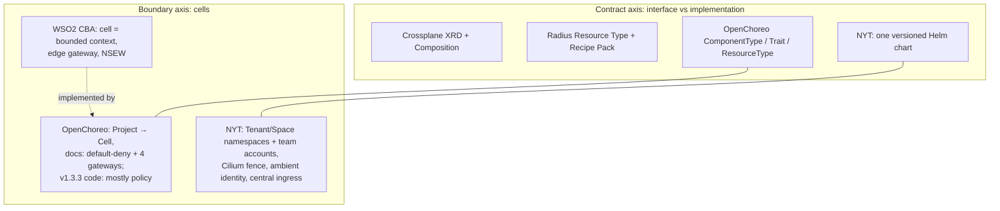

# OpenChoreo, cells, Radius and Crossplane

Written 2026-11-13 in answer to: *how would these ideas align with stuff like OpenChoreo and cell-based architectures based on WSO2's white paper?*. It follows [Radius in a DVSP-shaped platform](radius-in-nyt-dvsp.md). Evidence: WSO2 CBA paper, OpenChoreo docs v1.2.x, OpenChoreo README, the Radius sources, and [NYT DVSP](sources/nytimes-dvsp-developer-platform.md). The mapping and verdicts are this page's assessment; OpenChoreo was not installed for it.

## Two axes, not one

The Radius-vs-Crossplane question is about the **contract axis**: who owns the interface a team fills in, who owns the implementation behind it, and how an implementation change reaches running services. Cell-based architecture is about the **boundary axis**: what unit is deployed, isolated and governed together, and how traffic crosses between units. The tools sit differently on the two:

- **Crossplane** is contract-axis primitives only (XRD + Composition). Cells are something you would compose with it.
- **Radius** is contract axis plus an app graph. An Application is a logical grouping; the Radius docs read describe no network-isolation boundary for it.
- **WSO2 CBA** is boundary axis only: a cell is a bounded context, everything external crosses an edge gateway, in four directions (NSEW).
- **OpenChoreo** ships both. ComponentTypes, Traits and ResourceTypes are the contract; **Projects become Cells** at runtime with default-deny Cilium policy and NSEW gateways (per the docs; the v1.3.3 code ships neither default-deny nor per-cell gateways ([cell-traffic-nsew-tooling](cell-traffic-nsew-tooling.md))).
- **NYT DVSP** does both by hand: the Helm chart is the contract, and the Kubebuilder Tenant Operator plus Cilium and ambient identity draw the boundary.

## Side by side

| Concern | NYT DVSP today | Crossplane (+ admission glue) | Radius v0.62 | OpenChoreo v1.2.x |
|---|---|---|---|---|
| Interface teams fill in | Helm values | XRD schema | Resource Type (OpenAPI, dated version) | ComponentType parameters + Traits |
| Implementation | Chart templates, shipped with the interface | Composition (revisions, channels) | Recipe Pack per Environment | ComponentType/Trait/ResourceType CEL templates |
| Per-environment binding | Kustomize overlay per env | `compositionSelector` labels | Environment → Recipe Packs | ReleaseBinding per environment, pinning an immutable Release |
| Connections (dependency → env vars) | Chart values, by hand | Build it: Composition writes a Secret, mutating policy wires it | Built in: `CONNECTION_*` env vars | Built in: Workload resource dependencies inject outputs as env vars or file mounts; endpoint dependencies derive network policy |
| Cell boundary | Tenant Operator: namespaces + team cloud accounts | Build it (an XRD composing namespace + policies) | None in the docs read | Project → Cell: namespace, quotas, default-deny seeded first (per the docs; the v1.3.3 `default` ClusterProjectType creates only the namespace) |
| Cross-cell traffic | Mesh identity (ambient, waypoints); one central ingress per region | n/a | n/a | Docs: every cross-cell hop through a gateway. v1.3.3 code: shared kgateway north (+ optional internal west), direct pod-to-pod east via NetworkPolicy, egress unrestricted ([cell-traffic-nsew-tooling](cell-traffic-nsew-tooling.md)) |
| API surface | CRDs + Helm | CRDs | Aggregated API, not CRDs | CRDs (Platform API) |
| GitOps | Argo CD | Any (Argo CD, Flux) | Flux only | OpenChoreo controllers render and apply; Flux CD is the default GitOps module, Argo CD is listed as a "community module" but only `gitops-flux-cd` ships in `community-modules` (v1.3.3, [release-propagation-openchoreo-radius-2026-11](sources/release-propagation-openchoreo-radius-2026-11.md)) |
| Maturity | Production at NYT | CNCF graduated (v2) | CNCF Sandbox, `-preview` APIs | CNCF Sandbox, v1.x |

## Where the ideas align

- **OpenChoreo is "Radius's ideas on the Kubernetes API."** Its Workload dependencies do what Radius connections do, and its platform-authored templates do what Recipe Packs do, but as CRDs, so the Gatekeeper and `kubectl explain` objections to Radius do not apply. The mutating-admission glue proposed for Crossplane in the previous comparison is unnecessary there, because Traits govern the pod shape.
- **The cell paper explains NYT's Tenant Operator.** NYT's `Tenant` reconciling into namespaces, access and policy is the same move as OpenChoreo's ProjectReleaseBinding seeding a namespace and default-deny policy before any component deploys, as OpenChoreo's docs describe it. NYT built in-house what OpenChoreo's docs promise; its v1.3.3 code ships the namespace only ([cell-traffic-nsew-tooling](cell-traffic-nsew-tooling.md)).
- **Ownership rules line up.** Edinburgh's rule from the CBA talks, "one team can own many cells, no cell can be owned by several teams" (cell based architecture), fits NYT's model of a tenant (team) with extra `Space` namespaces, if each Space were treated as a cell (this page's inference).
- **The Radius/Crossplane contract split is what makes cells cheap to stamp out.** A cell is only replicable if its contents come from platform-owned templates. Without that split, every new cell copies a chart version and inherits the tenant-merge release train.

## Where they diverge

- **Gateways vs mesh identity (corrected 2026-11-13).** An earlier version of this bullet said the CBA paper *forces* a per-cell gateway, so NYT's central ingress diverged from it. That was wrong. The paper "prefers a unique gateway… per cell" but says "a shared gateway using a federated or centralized deployment pattern is acceptable" (wso2 cell based architecture raw). NYT's 2022 bet, one Envoy ingress per region with east-west governed by mesh workload identity, is therefore within the paper.
  - The Istio docs confirm that an ambient waypoint is a destination-side (westbound) gateway, once a ztunnel policy makes it the only door.
  - Eastbound has no documented source-side gateway in any tool.
  - OpenChoreo's own v1.3.3 code also implements the directions mostly as policy, not per-cell proxies.

  Details are in [cell-traffic-nsew-tooling](cell-traffic-nsew-tooling.md).
- **Cell = bounded context vs cell = team.** OpenChoreo's Project is a bounded context (DDD). NYT's tenant is a team plus its accounts. Those coincide only when team boundaries follow domain boundaries (team topologies).
- **Which kind of cell.** WSO2 cells are heterogeneous functional units; AWS-style cells are homogeneous replicas for blast-radius control (cell based architecture). OpenChoreo implements the WSO2 kind. NYT's region evacuation and per-cluster blast radius are closer to the AWS kind. Nothing in the OpenChoreo docs read covers replicated cells behind a router.
- **Adopt a platform vs compose primitives.** OpenChoreo is a full platform: control, data, workflow and observability planes, a Backstage portal and Thunder IAM. NYT's roadmap goal is "build on widely adopted components" and fewer custom ones. Adopting OpenChoreo replaces the scaffolder, chart, Tenant Operator and parts of observability at once. That is a bigger migration than Radius placement A or a Crossplane layer.

## The release-train question, again

**Answered 2026-11-16 from v1.3.3 code ([release-propagation-openchoreo-radius-2026-11](sources/release-propagation-openchoreo-radius-2026-11.md)) and confirmed on a k3d cluster the same day ([prototype-results](prototype-results.md)): PARTIAL.** A ComponentRelease freezes the ComponentType and Trait specs (CEL `self == oldSelf` on `spec.componentType` and `spec.traits`), and a ReleaseBinding renders only from that frozen copy, so a template edit never changes an existing Release. But the Component controller `Watches` ComponentType, ClusterComponentType, Trait and ClusterTrait. With `autoDeploy: true` (default `false`) a template change alters the release hash, so the controller cuts a new ComponentRelease and repoints the `<component>-<firstEnv>` binding, with no tenant change. Later environments still need promotion. **Live run:** editing the shared `service` ClusterComponentType cut a new release in the same second and repointed only `development`; a `staging` binding stayed put; with `autoDeploy: false` nothing re-released. So OpenChoreo gives the platform an automatic path to the *first* environment and an explicit promotion train after it, which is closer to SKE's staged rollout than to Kratix's floating bindings. The original question as framed on 2026-11-13 follows.

The question that decided the Radius analysis decides OpenChoreo too: **when the platform changes a ComponentType or Trait, do running components pick it up without a tenant change?** The docs say ComponentRelease snapshots the *parameters* and a ReleaseBinding pins an immutable Release per environment. Whether the snapshot also freezes the ComponentType template, which would make template changes wait for a new release just like a chart bump, is **UNVERIFIED** (the platform-abstractions and API-reference pages were deferred in the 2026-09-15 capture). Immutable releases are good for promotion and rollback, but they may reintroduce the release train NYT wants to remove.

## Assessment

For a team that wants both axes and Argo CD, OpenChoreo is the closest conceptual fit of the three: the contract split, connections and cells, all CRD-native. For an existing platform shaped like NYT's, borrow the ideas instead:

- A Crossplane XRD for the cell (namespace, Cilium default-deny, waypoint, quotas), replacing the bespoke Tenant Operator. This was later built and tested as `XCell` and is the basis of [recommendation](recommendation.md).
- XRDs and Compositions for workloads and data stores.
- Small mutating policies only for connection wiring.

Radius stays the multi-cloud and serverless option. Both OpenChoreo questions are now answered (below): release propagation is partial (autoDeploy to the first environment, then promotion), and GitOps is Flux by default, with an external Argo CD workable only if it ignores `ReleaseBinding.spec.releaseName`.

**Kratix, added 2026-11-13.** [kratix-in-nyt-dvsp](kratix-in-nyt-dvsp.md) finds Kratix the only option whose docs explicitly answer the release-propagation question: floating Resource Bindings re-run every request when a Promise changes, and staged rollout is enterprise-only (SKE). A `Cell` Compound Promise is a buildable alternative to the Crossplane cell XRD above.

## Open questions

- ~~Does a ComponentType or Trait change re-render already-released components, or only new Releases?~~ Only new Releases; `autoDeploy` cuts one automatically for the first environment (see above).
- ~~Which GitOps engine?~~ Flux by default (the workflow plane's Argo is Argo *Workflows*, for CI). **An external Argo CD can own the CRs, but not the binding's release name** (tested on k3d 2026-11-16, [prototype-results](prototype-results.md)). With Argo owning the Component, Workload and a dev ReleaseBinding pinned in Git, a template edit made OpenChoreo repoint the binding. Argo's self-heal then wrote Git's value back every 5 minutes, and OpenChoreo rewrote it within about 4 s; the binding's generation reached 20. `ignoreDifferences` on `/spec/releaseName` with `RespectIgnoreDifferences=true` ended the loop: Argo stayed Synced and autoDeploy kept working. Alternatively, keep ReleaseBindings out of Git.
- ~~Can a ResourceType wrap Crossplane claims or Terraform?~~ Crossplane claims yes (the ResourceType guide names them); Terraform only as a Workflow sample, not a ResourceType.
- Can a Trait add arbitrary pod annotations? This was already open in openchoreo agentic platform integration plan.

Related: [recommendation](recommendation.md), [radius-in-nyt-dvsp](radius-in-nyt-dvsp.md), cell based architecture, radius, crossplane, golden path, kubernetes multi tenancy, kubernetes admission control, cilium, istio, kgateway, wso2, openchoreo docs, wso2 cell based architecture, [nytimes-dvsp-developer-platform](sources/nytimes-dvsp-developer-platform.md).
