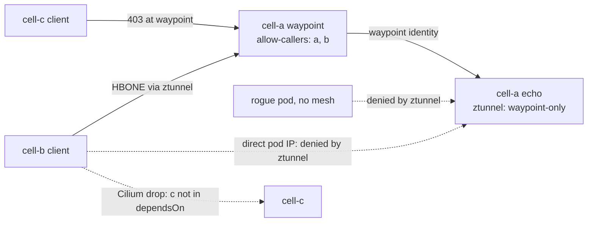

# Cell Promise prototype on kind

Run 2026-11-16 to test two things this write-up had only from docs: the per-direction mapping in [cell-traffic-nsew-tooling](cell-traffic-nsew-tooling.md) (west and east fences), and the open Kratix question in [kratix-in-nyt-dvsp](kratix-in-nyt-dvsp.md) (does a Promise edit without a version bump re-run bound requests?). This is a first-party experiment, not a source; the cluster was local and has no bearing on production sizing.

**Stack.** kind (1 control plane, 1 worker, default CNI disabled), Cilium 1.20.4 (`cni.exclusive=false`, `socketLB.hostNamespaceOnly=true`; later `k8sClusterNetworkPolicy.enabled=true` for the ClusterNetworkPolicy tests), Istio 1.32.0 ambient via Helm (base, istiod `profile=ambient`, istio-cni, ztunnel), Gateway API v1.5.0 standard CRDs, cert-manager v1.19.1, Kratix `latest` (release published 2026-11-14) with its all-in-one config (MinIO bucket State Store + Flux, same-cluster Destination `worker-1`). k3d was the first plan; kind was used because Cilium documents kind and k3d needs manual bpffs mounts in the node containers.

**Setup gotcha.** Istio's Helm repo moved: `istio-release.storage.googleapis.com/charts` stops at 1.30.8, and `gcr.io/istio-release/charts` has no 1.31/1.32. The ambient Helm install doc now uses `https://blob.istio.io/istio-release/charts`.

## What the Promise renders

One `Cell` request (`spec.allowFrom`, `spec.dependsOn`, both lists of cell names) becomes, via a one-container pipeline (`mikefarah/yq` with `command`/`args`, no custom image):

- Namespace `cell-<name>` labelled `istio.io/dataplane-mode: ambient`, `istio.io/use-waypoint: waypoint`.
- Gateway `waypoint` (`gatewayClassName: istio-waypoint`, HBONE 15008) — the west door.
- AuthorizationPolicy `waypoint-only` (namespace-wide, enforced by ztunnel): ALLOW only principal `cluster.local/ns/cell-<name>/sa/waypoint` — the west fence.
- AuthorizationPolicy `allow-callers` (`targetRefs` the waypoint): ALLOW source namespaces = own cell + `allowFrom` cells.
- CiliumNetworkPolicy `east-allowlist`: egress only to own cell, kube-dns, `istio-system` and each `dependsOn` cell — the east fence.

Cells requested: **a** (`allowFrom: [b]`), **b** (`dependsOn: [a]`), **c** (`dependsOn: [a]`, not allowed by a), plus a non-mesh namespace `rogue`. Each has an agnhost echo server and a curl client.

## Results

| Case | Designed outcome | Result | Without the fence (control) |
|---|---|---|---|
| b → a Service (allowed caller, declared dep) | 200 | 200 | 200 |
| c → a Service (declared dep, not in allowFrom) | 403 at waypoint | 403 | 403 |
| b → c Service (not a declared dep) | dropped by Cilium | connect fail | **403** with `east-allowlist` deleted: traffic then reaches c's waypoint, which also refuses |
| a → a Service | 200 | 200 | 200 |
| rogue (out of mesh) → a Service | denied | connect fail | **200** with `waypoint-only` deleted |
| rogue → a pod IP:8080 | denied | connect fail | **200** with `waypoint-only` deleted |
| b → a pod IP:8080 (in mesh, skips waypoint) | denied | connect fail | **200** with `waypoint-only` deleted |

Manifests, scripts and raw transcripts (`run1.txt`, `control.txt`, `run2.txt`, …) are in `../prototype/` in the repo; its README gives the rerun order.

**What this confirms.**

- **The path/fence split is real, not theoretical.** `use-waypoint` alone left three bypasses open, including an out-of-mesh pod reaching the cell through its Service name with a 200. The Istio docs' "does not guarantee" caveat ([cell-traffic-docs-2026-11](sources/cell-traffic-docs-2026-11.md)) reproduces exactly, and the ztunnel waypoint-only policy closes all three.
- **East allow-list from declared dependencies works with ambient.** Cilium sees the HBONE leg as pod-to-pod traffic toward the destination namespace and drops it before the waypoint. With it removed, the destination waypoint's caller allow-list still refuses, so the two layers are defence in depth.
- **Flux self-heals a deleted fence.** With the Kratix Flux Kustomization resumed, both deleted policies were back within ~20 s. Tenant RBAC must still forbid editing them; self-heal only narrows the window.

## Kratix: Promise edit without a version bump

The Promise was re-applied with only the template changed (a namespace label `platform.example.org/cell-template` from `v0.1.0` to `v0.1.0-edited`), keeping `kratix.io/promise-version: v0.1.0`.

- **Every bound request re-ran.** Edit applied 16:37:14Z; new pipeline pods for a, b and c were created at 16:37:15Z and succeeded. All three namespaces carried the new label after Flux applied.
- **No new revision.** `kubectl get promiserevisions` still showed a single `cell-… v0.1.0 latest=true`; the three ResourceBindings stayed `DESIRED latest`, `APPLIED v0.1.0`.

So the docs' "the existing Promise Revision will be updated" does mean live, fleet-wide re-rendering. **Consequence for the release-train question:** an unversioned edit is an instant, unstaged rollout to every floating request. Requests *pinned* to that version are hit too: confirmed in round 2 below. Platform teams should treat the version label as mandatory (a CI or admission check that rejects a Promise spec change without a label bump would enforce it; inference, not tested).

## Round 2: north, south, pinning and Argo CD (same day)

Promise **v0.2.0** added an optional `spec.hostname`. A public cell gets a ListenerSet and HTTPRoute on the shared gateway, the namespace label `istio.io/ingress-use-waypoint: "true"`, and `platform-ingress` in its caller allow-list. Every cell's east allow-list also gained `istio-egress`. The platform side (not per cell) is:

- **North door:** Gateway `north` in `platform-ingress` (class `istio`), with `allowedListeners` from namespaces labelled `cell`.
- **South door:** namespace `istio-egress` with a waypoint, a `httpbin.org` ServiceEntry, and an AuthorizationPolicy allowing only `cell-b`.
- **South fence:** ClusterNetworkPolicy `platform-deny-world-egress`, tier Admin, which denies `0.0.0.0/0` egress from every `cell` namespace.

**Release train.** Installing v0.2.0 created a second PromiseRevision. All three floating bindings moved to `APPLIED v0.2.0` with no change to any Cell request.

| Case | Designed | Result | Control |
|---|---|---|---|
| N1 internet → `a.example.test` | 200 from cell-a | 200, cell-a's pod | **503** with `ingress-use-waypoint` removed: the gateway's own identity hits cell-a's waypoint-only fence |
| N2 internet → `b.example.test` (not public) | 404 | 404 | |
| N3 cell-c ListenerSet claiming `a.example.test` | rejected | `Accepted=False HostnameConflict`; traffic stayed on cell-a (3/3) | first come, first served, as the Gateway API docs say |
| S1 b → `httpbin.org` (ServiceEntry, allowed) | 200 via egress waypoint | 200 | |
| S2 c → `httpbin.org` | 403 at egress waypoint | `RBAC: access denied` 403 | |
| S3 b → `example.com` (no ServiceEntry) | blocked | connect fail | still blocked with cell-b's own CiliumNetworkPolicy deleted; **200** once the Admin ClusterNetworkPolicy is also deleted |
| S4 out-of-mesh pod → `example.com` | 200 (baseline) | 200 | |

**What round 2 adds:**

- **A waypoint-only fence breaks north unless ingress traverses the waypoint.** The ingress gateway is a separate identity. Either set `istio.io/ingress-use-waypoint` (Istio 1.25+) and allow the ingress namespace at the waypoint, or the fence must also admit the gateway's principal. This coupling between the west fence and the north path isn't spelled out in any page captured so far.
- **The Admin tier is what makes the south fence tenant-proof.** With the tenant's own namespaced allow-list deleted, the Admin ClusterNetworkPolicy alone still blocked direct internet egress. The egress waypoint (in `istio-egress`, not a subject) still worked.
- **ListenerSet hostname ownership is enforced by the gateway**, but only first come, first served. The platform still needs to allocate hostnames, for example with Gatekeeper on ListenerSet `hostname`.

### Kratix pinning

Pinning cell-c's ResourceBinding (`spec.version: v0.2.0`), then:

- **An unversioned edit of v0.2.0 re-ran the pinned request too** (all three pipeline pods were created in the same second). Pinning protects against version bumps, not in-place edits.
- **A v0.3.0 bump moved a and b** (floating) and left c on v0.2.0. Editing c's binding to `v0.3.0` moved it within about 40 s.

### Kratix with Argo CD

The setup was a second Destination `argo-worker` on a GitStateStore (Gitea 1.26 in-cluster, chart 12.6.0) and Argo CD v3.5.7 with the two Applications exactly as the Kratix guide gives them (automated, prune, selfHeal, no ordering).

- **Gotchas:** a GitStateStore with `basicAuth` rejects `http://` ("invalid URL for HTTPS auth method"), so SSH was used. Gitea's SSH Service is headless, so the port is the container's 2222, not 22. `Destination.spec.path` is required.
- **Happy path:** a Promise whose resource is an instance of a CRD shipped as its own dependency synced in about 70 s, with dependencies applied one second before resources. The race didn't show.
- **Forced gap:** with auto-sync disabled on the dependencies app, the resources app failed with `Gadget.probe.example.org "" not found` and retried. Once dependencies synced, resources recovered about 30 s after the CRD appeared, after three automatic retries. No `retry` block was configured, so Argo CD 3.5.7 retried failed auto-syncs by default (observed; not checked against Argo docs).

So the ordering gap costs latency, not a stuck application, on this Argo version. Sync waves or an explicit `retry` policy make it deterministic.

## kgateway egress credential injection

kgateway v2.5.2 ran on this cluster as an egress Gateway with a Static Backend (`httpbin.org`) and a TrafficPolicy, `headerModifiers.request.set: [{name: X-Api-Key, secretRef: {name: httpbin-api-key, key: X-Api-Key}}]`. httpbin's `/headers` echo showed:

- **Injected:** a client with no key arrived upstream with the Secret's value.
- **Not forgeable:** a client-sent `X-Api-Key: forged` was overwritten (`set`, not `add`).
- **Control:** with the TrafficPolicy deleted, no key was sent.
- **Rotation:** changing the Secret value took effect within about 10 s, with no restart.

So the southbound "credential injection" the cell paper and OpenChoreo describe works today with kgateway, with no custom code. Pair it with the Admin-tier egress deny so the gateway is the only way out.

## Also run: OpenChoreo and Radius

These ran on a separate k3d cluster (OpenChoreo v1.3.3 via its own `install/k3d/k3d-install.sh`, control and data planes) and in this cluster (Radius v0.62.0 with `--skip-contour-install`). Results are in [release-propagation-openchoreo-radius-2026-11](sources/release-propagation-openchoreo-radius-2026-11.md) and [openchoreo-cells-radius-crossplane](openchoreo-cells-radius-crossplane.md).

- **OpenChoreo autoDeploy, live.** Editing the shared `service` ClusterComponentType created a new ComponentRelease in the same second, repointed only the `development` binding, and the development Deployment carried the new annotation. A manually created `staging` binding stayed on the old release. With `autoDeploy: false`, a further edit created no release.
- **Radius and admission, live.** A ValidatingAdmissionPolicy denying all writes to `api.ucp.dev` did not stop `rad group create`, while the same policy did block a normal CRD write. Denying writes to Radius's storage CRDs (`ucp.dev`) did block it, surfacing as `"code": "Internal"`. Those objects are hashed names wrapping opaque `entries` blobs, so admission can veto Radius state writes but can't usefully read them. **Rendered objects are governed:** with a policy denying Deployments in the environment namespace, `rad deploy` of a one-container app failed with that policy's own message ("failed to deploy recipe default of type Radius.Compute/containers" wrapping the denial). Without the policy, the same deploy completed and the Deployment ran.
- **Radius setup without a TTY:** `rad initialize` needs a TTY. By hand, create the `default` resource group, run `rad bicep download`, `rad deploy` the community `kubernetes` recipe pack, create the namespace (`rad env create` refuses a missing one), then `rad env create --recipe-packs default`. On a plain `rad install` the docs' "created within Radius and named `default`" pack did not exist.
- **Setup gotchas:** Radius's bundled Contour fails if Gateway API CRDs already exist (Helm ownership); OpenChoreo's installer switches the current kube context.

## Round 3: REGISTRY_ONLY, v1beta1 CRD, Argo CD over OpenChoreo, mutation vs diff

- **REGISTRY_ONLY:** with it set in meshConfig, a sidecar pod got **502** for `example.com` while an ambient pod got **200**. An ambient pod's call to the `httpbin.org` ServiceEntry got 403 at the egress waypoint (cell-b only). A sidecar pod reached the same host with **200**, bypassing the ambient egress waypoint's allow-list. Mixed sidecar and ambient clusters need the network fence for sidecars too.
- **network-policy-api v0.3.0 CRD on Cilium 1.20.4:** applying the v0.3.0 standard CRD over `release-0.2` gives `v1alpha2` (served) and `v1beta1` (served, storage). A ClusterNetworkPolicy created as `v1beta1` (Admin, deny b → a) was enforced, and removing it restored the 200.
- **External Argo CD owning OpenChoreo CRs (k3d-openchoreo, Argo CD v3.5.7 + Gitea):** Argo owned the Component (`autoDeploy: true`), Workload and dev ReleaseBinding, with the binding's `releaseName` pinned in Git. After a ClusterComponentType edit, OpenChoreo repointed the binding. Argo's self-heal reverted it every 5 minutes (19:32, 19:37, 19:42), and OpenChoreo's manager rewrote it within about 4 s each time; generation reached 20. Adding `ignoreDifferences: [{group: openchoreo.dev, kind: ReleaseBinding, jsonPointers: [/spec/releaseName]}]` with `RespectIgnoreDifferences=true` kept the app Synced, and the next template edit rolled out with one binding write.
- **Gatekeeper mutation vs Argo CD diff (Gatekeeper 3.22.2):**

| Mutation | Default diff | `ServerSideDiff=true` |
|---|---|---|
| Adds a field Git doesn't set (`allowPrivilegeEscalation: false`) | Synced | Synced |
| Overrides a field Git sets (`imagePullPolicy` → `Always`) | **OutOfSync** | Synced |

Under the default diff, the overriding case never settled. Argo re-ran its sync six times in about 15 minutes, and each apply was mutated straight back, so the Deployment's generation stayed at 1. The result is sync churn with no live change.

## Round 4: tenant-proof east fence, and the Crossplane twin

- **East fence as a CiliumClusterwideNetworkPolicy.** Replacing cell-b's namespaced `east-allowlist` with an equivalent CCNP selecting `k8s:io.kubernetes.pod.namespace: cell-b` gave the same results: b → a 200, b → c blocked, b → a's pod IP blocked. A ServiceAccount bound to the built-in `admin` ClusterRole in `cell-b` could not delete the CCNP, and by default could not delete the namespaced CiliumNetworkPolicy or Istio AuthorizationPolicy either: those CRDs don't aggregate into `admin`. The tenant-proofing risk is therefore whatever RBAC the platform grants on those kinds.
- **Crossplane 2.4.2 `XCell`** (cluster-scoped XRD; a go-templating v0.13.1 Composition renders a Namespace and a CCNP east fence from `spec.dependsOn`). Three XCells: `p` (default `Automatic`), `q` (`Manual`), `s` (`compositionRevisionSelector: {channel: stable}`).

| Composition change | Revisions | p (Automatic) | q (Manual) | s (channel stable) |
|---|---|---|---|---|
| start | rev 1 `stable` | r1 | r1 | r1 |
| edit, labelled `channel: dev` | + rev 2 `dev` | **r2** | r1 | r1 |
| edit, labelled `channel: stable` | + rev 3 `stable` | **r3** | r1 | **r3** |
| `q.spec.crossplane.compositionRevisionRef` → rev 3 | | r3 | **r3** | r3 |

What this shows against the Kratix results above:

- **Every Composition edit made a new immutable revision.** Crossplane has no unversioned-edit hazard; Kratix re-ran every request, pinned or floating, on an in-place edit.
- **Open-source staged rollout works.** Channel labels on revisions plus `compositionRevisionSelector` on the XR gave dev-first, then stable, with no paid add-on. Kratix needs SKE or a hand-written binding patcher.
- **The pin lives on the XR.** Kratix keeps it on a separate platform-owned ResourceBinding. That only matters if tenants author the XR; at NYT the platform writes the `Tenant`.
- **Cluster-scoped composition is fine from a cluster-scoped XR.** The v2 gotcha (a namespaced XR can't compose cluster-scoped resources) didn't apply.

## Round 5: Argo CD hub ships XCells, Crossplane renders on each cluster

The hub is `kind-cellproto`'s Argo CD v3.5.7. Spokes: `dev` = the hub cluster itself; `prod` = the k3d `openchoreo` cluster, registered through a ServiceAccount token and reached by connecting its server container to the `kind` Docker network. Both run Crossplane 2.4.2. One ApplicationSet (list generator, two sources: `platform/` with the XRD, Composition `xcell-np` and RBAC; `envs/<env>/` with the cell) ships to both. Dev's `hub1` uses `Automatic`; prod's selects `channel: stable`.

| Git commit | dev | prod |
|---|---|---|
| h1, Composition labelled `stable` | rev 1, h1 | rev 1, h1 |
| h2, labelled `dev` | **rev 2, h2** | sees rev 2, stays on rev 1, h1 |
| same h2, relabelled `stable` | rev 3, h2 | **rev 3, h2** |

- **Per-environment channels work through one repo and one ApplicationSet.** The environment difference is a single selector line in `envs/prod`. Both apps stayed Synced/Healthy throughout; the `compositionRevisionRef` Crossplane writes onto each XR isn't in Git, so Argo ignores it.
- **First sync to a fresh cluster fails without `SkipDryRunOnMissingResource=true` on the XR.** Argo validates the whole set before applying anything, so the XCell kind was unknown and five retries failed with "failed to discover server resources" even though the XRD sat in an earlier sync wave. The sync-option annotation on the XCell fixed it.
- **Local drift repair is fast.** Deleting prod's rendered NetworkPolicy saw it recreated in about 10 s by prod's own Crossplane.

## Round 6: data stores in per-team accounts, and reusing Terraform modules

The setup was a dedicated floci 2.5.0 (`xp-floci`, port 4590, Docker resource namespace `xp`), attached to the `kind` network. In floci a 12-digit access key id is an isolated account, so team-a = `111111111111` and team-b = `222222222222`.

**Crossplane-native Database.** The pieces:

- provider-aws-rds v2.8.1, with provider-family-aws v2.9.0.
- A namespaced `Database` XRD whose Composition renders a namespaced `rds.aws.m.upbound.io` Instance that references ProviderConfig `aws`.
- Each team namespace holds its own platform-owned `aws` ProviderConfig (credentials Secret with the team key; static floci endpoint).

One Composition serves every team, because a namespaced MR resolves the ProviderConfig in its own namespace. A `Database orders` in each team namespace produced one Postgres instance in each team account and none in the default account. floci ran each as a real Postgres container. Re-run on 2026-11-19 with the provider pods behind the egress fence: both Databases were Ready in 91 s, with the same placement, and no traffic from the providers was dropped. A probe pod with the provider's label was blocked from real STS, and the drop monitor recorded it, so the fence and the monitor both worked.

**Terraform modules through provider-opentofu v1.1.10.** Both are public, Apache-2.0 modules from the public registry. Both rows below were run on 2026-11-18 (kind, Cilium 1.20.4, Crossplane 2.4.2, floci 2.5.0), with the provider pod behind the egress fence. It resolved only `registry.opentofu.org`, `github.com` and `release-assets.githubusercontent.com`, and no non-ICMP traffic was dropped:

- `cloudposse/dynamodb/aws` 0.37.0.
- `terraform-aws-modules/rds/aws` 6.13.1.

Each team namespace got an OpenTofu ProviderConfig whose `configuration` sets the AWS provider's floci endpoints and whose `credentials` writes the team's key file.

| Workspace | Module | Landed in | Output surfaced |
|---|---|---|---|
| team-a `sessions-table` | Cloud Posse DynamoDB | team-a's account only (`sessions` table) | `table_name: sessions` |
| team-b `billing-db` | terraform-aws-modules RDS, with an inline VPC and two subnets | team-b's account only (Postgres `billing` in VPC `10.20.0.0/16`) | `db_endpoint` |

Changing `allocated_storage` from 20 to 30 in the Workspace was applied to the instance in about 80 s (81 s in the 2026-11-18 run).

Gotchas, in the order they bit:

- **Readiness with go-templating.** XRs stayed `Ready=False` ("Unready resources: db") while every composed resource was ready. function-go-templating doesn't derive readiness: add a `function-auto-ready` step (v0.6.0 here). Composed kinds with no Ready condition, such as a CiliumClusterwideNetworkPolicy, also need `gotemplating.fn.crossplane.io/ready: "True"`. With both, XCells and Databases went Ready. Revisions created before the fix (XCell `q`, pinned) stay not-ready.
- **Argo CD reported the hub XCell Healthy while its XR was `Ready=False`.** Argo has no built-in health check for a custom XR kind, so it needs a `resource.customizations` health check (not added here).
- **The Cloud Posse DynamoDB module calls KMS.** Without a `kms` entry in the OpenTofu ProviderConfig's `endpoints`, that call goes to `kms.us-east-1.amazonaws.com`. Unfenced runs still succeeded, so the leak was silent. Behind the fence, `tofu apply` hung on it until `kms` was pointed at floci.
- **A provider restart mid-apply leaves a state lock.** The `kubernetes` backend's Lease (`lock-tfstate-<workspace>-<suffix>` in `crossplane-system`) stays held by the dead pod, and every later run fails with "the state is already locked". Delete the Lease.
- **Module version constraints follow the bundled OpenTofu.** provider-opentofu v1.1.10 ships OpenTofu 1.10.0, so `terraform-aws-modules/rds` 7.x (`required_version >= 1.11.1`) fails `init` with "Unsupported OpenTofu Core version". 6.13.1 works.
- **provider-opentofu with no backend fails on the first observe** with "No state file was found!" from `tofu state list`.
- **`backendFile` is partial backend config.** It is written to `crossplane.remote.tfbackend` and passed to `init -backend-config=`, so it holds `key = value` pairs only, and the module declares an empty `terraform { backend "kubernetes" {} }`. A full `terraform {}` block in `backendFile` fails the same way as no backend.

## Round 7: Argo CD health for XRs, and cross-account IAM (2026-11-17)

**Argo CD health checks.** I added a Lua `resource.customizations.health.platform.example.org_XCell` (and `_Database`) to `argocd-cm`: `Synced=False` → Degraded, `Ready=True` → Healthy, otherwise Progressing. Both hub apps went from Healthy to **Progressing** while hub1's XR was `Ready=False`. Pushing `function-auto-ready` and ready annotations through Git turned both XRs Ready, and both apps went **Healthy** within about 35 s. The Degraded branch wasn't exercised.

**Cross-account IAM shape.** Tenant ProviderConfigs hold no team keys. One platform identity (account `999999999999`) assumes `crossplane-provisioner` in each team account; the role's trust policy names only the platform account and its permissions are `rds:*` only.

| Check | floci default (`IAM_ENFORCEMENT` off) | floci with `FLOCI_SERVICES_IAM_ENFORCEMENT_ENABLED=true` |
|---|---|---|
| Platform assumes team-a's role | Credentials resolve to `111111111111`, and see team-a's databases | Same |
| Untrusted account assumes team-a's role | **Allowed**: the trust policy is not checked | `AccessDenied` |
| Role that doesn't exist | `AccessDenied` | `AccessDenied` |
| Crossplane `assumeRoleChain`, platform identity (`iam-a`) | — | RDS Ready in `111111111111` only |
| Crossplane `assumeRoleChain`, untrusted identity (`iam-b`) | — | MR `AccessDenied` on `sts:AssumeRole` |

floci's own docs say account selection by access key "is not proof that the caller possesses the corresponding secret". Trust-policy tests need enforcement on.

The enforcement-on column was re-run on 2026-11-19 with both provider pods behind the egress fence and the `AWS_ENDPOINT_URL_STS` workaround applied. Every row matched. No traffic from the providers was dropped, so the role-assumption calls stayed on floci.

**Leak to real AWS, and the fix.** provider-aws-rds v2.8.1 (family v2.9.0) sends the STS AssumeRole for `assumeRoleChain` to **`https://sts.us-east-1.amazonaws.com`**. It ignores the ProviderConfig `endpoint`, even with `sts` in `endpoint.services`.

- **The leak.** For about 7 minutes, two probe Databases retried signed AssumeRole calls against real AWS STS. They carried floci placeholder keys only, so AWS rejected them with `InvalidClientTokenId`; no real credentials were involved and nothing was created.
- **How it was proven.** A Cilium egress fence on the provider pods (API server, DNS, cluster and the two floci IPs only) turned the error into `dial tcp 13.217.79.240:443: i/o timeout`.
- **The fix.** `AWS_ENDPOINT_URL_STS` set on the provider pod through a DeploymentRuntimeConfig sent STS to floci, and the rows above passed with the fence still on.

**Role permission scoping (enforcement on).** I cut team-a's role to `rds:Describe*`:

- A new `Database` failed with `AccessDenied … not authorized to perform: rds:CreateDBInstance`, surfaced on the MR. The 2026-11-19 fenced re-run got the same result: a 403 on `CreateDBInstance`.
- The existing database kept syncing Ready on Describe alone.
- No instance was created.
- The denied MR stayed stuck deleting (finalizer held) until `rds:*` was restored, then cleared in about 10 s with nothing created. This was observed, not root-caused.

The root cause of the STS leak is in provider-upjet-aws v2.8.1 (09d38f54), `internal/clients/provider_config.go`: `GetRoleChainConfig` (line 194) builds each chain link's STS client before `SetResolver` (line 198) installs the custom endpoint resolver. Reported upstream as [crossplane-contrib/provider-upjet-aws#2328](https://github.com/crossplane-contrib/provider-upjet-aws/issues/2328) (2026-11-17). The fix is open as [#2329](https://github.com/crossplane-contrib/provider-upjet-aws/pull/2329). It moves `SetResolver` before the chain and carries the resolver into each link. Its new unit test runs a two-role chain against an `httptest` fake STS: it fails on `main`, fails with the reorder alone (the second hop still leaks), and passes with the full change. A second commit on the same PR fixes the **WebIdentity** credential source, which had the same flaw: `UseWebIdentityToken` built its STS client from a default config with no endpoint resolver, so `AssumeRoleWithWebIdentity` also went to public STS. Its test fails without that commit and passes with it. IRSA and PodIdentity, which use the SDK's default chain, are out of scope; `AWS_ENDPOINT_URL_STS` still applies to them.

When testing Crossplane against an emulator, fence the providers first. On real AWS the same behaviour would matter wherever STS must go to a private or regional endpoint (inference).

## Round 8: the whole cell from one Crossplane composition (2026-11-23)

Rounds 1 to 3 rendered the cell with the Kratix Promise. Round 4's Crossplane `XCell` rendered a Namespace and the east fence only. This round ports the rest, on a fresh kind cluster (`cellxp`) with no Kratix, Flux, MinIO or cert-manager: Cilium 1.20.4 with `k8sClusterNetworkPolicy.enabled=true`, Istio 1.32.0 ambient, Gateway API v1.5.0, Crossplane 2.4.2 and function-go-templating v0.13.1.

One cluster-scoped `XCell` (`allowFrom`, `dependsOn`, `hostname`) renders the ambient Namespace, the waypoint Gateway, the `waypoint-only` and `allow-callers` AuthorizationPolicies, a CiliumClusterwideNetworkPolicy east fence, and for a public cell a ListenerSet and HTTPRoute. The platform side (`kind/platform-ns.yaml`) and both test scripts are unchanged.

| Matrix | Result | Control |
|---|---|---|
| West and east, 7 cases (`kind/test.sh`) | All 7 as designed, identical to round 1 | With XCells `a` and `b` paused and cell-a's `waypoint-only` and `east-cell-b` deleted: the three bypasses returned **200** and b → c reached c's waypoint (**403**), as in round 1 |
| North and south, 6 cases (`kind/test-ns.sh`) | All 6 as designed, identical to round 2 | With the Admin ClusterNetworkPolicy also deleted, b → `example.com` returned **200** |
| After unpausing and re-applying the ClusterNetworkPolicy | All 13 as designed | |

**What round 8 adds:**

- **Crossplane alone renders the full cell.** The recommendation no longer rests on an inference from the Kratix runs.
- **Drift repair is faster than a poll can see.** With the XCell not paused, a deleted `waypoint-only` policy was back before the first 1-second poll. Round 5 measured about 10 s for a NetworkPolicy through the hub setup; this is one cluster and one sample.
- **A negative control needs the XR paused.** `crossplane.io/paused=true` on the XCell is what lets a fence stay deleted long enough to test. That is the tenant-proofing working, and it is also the step a conformance suite has to automate.
- **Every composed kind needed the explicit ready annotation.** None of Namespace, Gateway, AuthorizationPolicy, CiliumClusterwideNetworkPolicy, ListenerSet or HTTPRoute has a `Ready` condition, so the XCell reports Ready once the objects are applied, not once the waypoint is Programmed. The test waited for the waypoint separately.

Not covered by this round: N3 (the duplicate-hostname conflict), revision channels on the full composition, and the hub delivery of round 5. Raw output: `round8-west-east.txt`, `round8-north-south.txt`, `round8-controls.txt`.

## Not tested

Cross-cluster cells, SKE UpgradePlans, Argo CD sync waves, and MutatingAdmissionPolicy (not served on this v1.35 kind cluster without a feature gate; Gatekeeper mutation stood in).

Related: [recommendation](recommendation.md), [cell-traffic-nsew-tooling](cell-traffic-nsew-tooling.md), [kratix-in-nyt-dvsp](kratix-in-nyt-dvsp.md), kratix, istio, cilium, cell based architecture, kubernetes network policy, gateway api.
