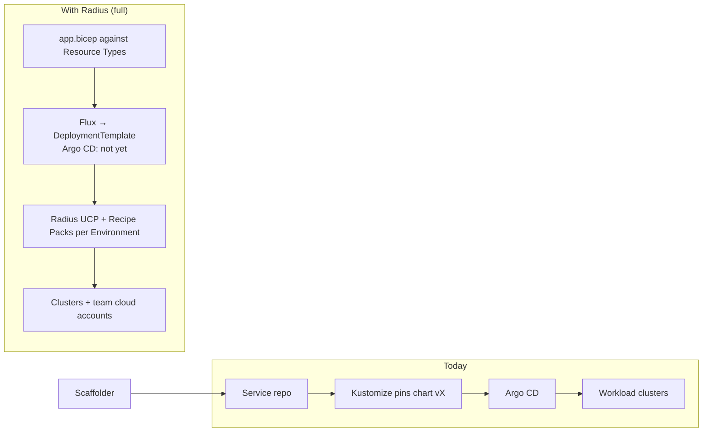
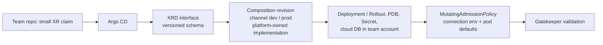

# Radius in a DVSP-shaped platform

Written 2026-11-12 in answer to: *the Helm-as-contract contradiction is the one I ran into; I was interested in Radius, which is similar to or replaces KubeVela. Where does it fit in this platform, and what problems would it solve?*. Evidence: [NYT DVSP](sources/nytimes-dvsp-developer-platform.md) for the problems; Radius docs v0.62, FAQ v0.52 and 2026 releases + Argo CD issues for Radius. The verdicts are this page's assessment, labelled as such. Radius was not installed for the original analysis; its admission behaviour was later tested on kind ([prototype-results](prototype-results.md)).

## The root problem, restated

NYT's platform chart is **one artifact carrying two things that change at different rates and have different owners**: the *interface* (the values a team sets) and the *implementation* (what the chart renders). Because both ship in one semver, every implementation change, such as adding ambient-mesh labels, a PDB tweak or a pre-stop delay, needs every tenant to merge a chart bump. And because one chart covers every capability, its interface keeps growing until "the values file became the new YAML". Farcic puts the same diagnosis in category terms: templates are client-side, so the platform can't change behaviour under a running app.

**Radius's design is exactly that split.** A Resource Type (dated API version + OpenAPI schema) is the interface. A Recipe Pack, bound per Environment, is the implementation. The Radius docs: "Changing the Recipe Pack changes how resources are deployed without changing the applications that use them."

## NYT's reported problems, one by one

| NYT problem (DVSP source) | Would Radius solve it? | Notes |
|---|---|---|
| **Platform changes ride on tenant merges** (ambient waited on every chart bump; Renovate shortens, can't remove) | **Mostly yes.** The implementation moves server-side into Recipe Packs, swapped per Environment by the platform team | Two caveats: (1) a pack change does **not** reach already-running apps: the v0.62 Recipe Pack PUT is a plain save, recipes run only inside each resource's own PUT, and the docs say a change "affects subsequent deployments" (checked 2026-11-16, [release-propagation-openchoreo-radius-2026-11](sources/release-propagation-openchoreo-radius-2026-11.md)). A redeploy trigger is required, now a platform-owned CI/Flux event rather than a tenant PR. (2) It removes the tenants' opt-in safety valve; staged rollout becomes "update the dev Environment's pack first". |
| **The values file became the new YAML** | **Partly.** Many small per-type schemas (`containers`, `routes`, `postgreSqlDatabases`, or a bundled "web service") replace one mega values file | The community container schema is already 25 KB and has an untyped `platformOptions: additionalProperties: any` escape hatch, which is a values file in waiting. Discipline, not the tool, keeps types small. |
| **Kustomize patch as escape hatch** for what the chart doesn't expose | **Changes shape.** Patches move into `platformOptions` or a new API version of the type | Breaking interface changes get a new dated API version, so old apps keep the old contract. That is cleaner than a chart major bump. |
| **Paved paths beyond containers** (NYT's own "what's next": serverless + data-store paths) | **Yes, this is Radius's core use case.** `Radius.Data/*` types with Terraform recipes targeting RDS etc.; connections inject `CONNECTION_*` env vars; containers retargetable by pack (`azure-aci`) | AWS has only an `aws-eks` pack in contrib, with no ECS/Lambda pack, so an AWS serverless path would be a custom recipe. |
| **Shared ownership erodes** (chart core team + code owners) | **Clearer seams.** A Resource Type and its recipe can each have one owning team (Application Delivery owns rollout-related types, Edge owns `routes`) | Org design, not a technical guarantee. |
| **Opt-in resilience at creation time** (multi-region in the scaffolder) | Neutral. Could be an Environment layout (region per Environment) | Evacuation-by-routing stays at the CDN and gateway layer. |
| **Autoscaler coupling, ambient density, PDB-stalled drains** | **No.** Cluster-operations problems, below Radius's layer | Radius's container recipe renders an HPA only, so NYT's KEDA pre-scaling would be custom recipe work. |

## What it would cost NYT today (as of v0.62, 2026-11-12)

1. **Argo CD.** GitOps is Flux-only. Argo CD support is at design stage (CMP sidecar vs in-cluster compile undecided, #12998/#13323). NYT chose Argo CD for its multi-tenant UI, SSO and notifications (argo cd), so this is the blocker today.
2. **Kubernetes-API visibility.** Radius is "not a Kubernetes controller and the primary user experience is not through custom resources". Its API is an aggregated API (UCP). The Gatekeeper/Kyverno consequence is now **tested for the API half** (2026-11-16, [prototype-results](prototype-results.md): a deny-all ValidatingAdmissionPolicy on `api.ucp.dev` let `rad group create` through, while the same policy blocked a normal CRD write). The original reasoning ([release-propagation-openchoreo-radius-2026-11](sources/release-propagation-openchoreo-radius-2026-11.md)): Radius's chart registers `api.ucp.dev` as an APIService, and the Kubernetes aggregation docs show the *aggregated* server running admission for requests kube-apiserver proxies to it, so kube-apiserver webhooks would not see Radius resource writes. The Kubernetes objects recipes render afterwards are ordinary server-side-apply writes that webhooks do see, which was confirmed with `rad deploy` on the same day. So NYT's Rego policy would govern only the objects recipes *render*, not the Radius resources developers submit. Policy would move into the recipes, which is what Radius intends ("Recipe Packs are… how a platform enforces… best practices"), but it is a second policy plane. Farcic's discoverability point is half-met: per-type schemas exist (`rad resource-type show`, a Bicep extension, the Dashboard), but `kubectl explain` and the CRD-consuming ecosystem don't see them.
3. **Bicep for every team.** Application definitions are Bicep only. NYT's tenants currently write Helm values plus Kustomize. That is a new language for 100+ teams, though one with type checking from the published extension.
4. **No incremental path from the existing chart.** The annotate-your-Helm-chart onboarding was **removed in v0.61**. Migration means rewriting each service's definition, which is the "migration campaign" NYT's lesson warns against.
5. **Re-encoding the chart.** The default container recipe renders only Deployment + Service + HPA. NYT's chart features (Argo Rollouts canary + analysis, Istio VirtualService and baggage routing, PDB, AZ spread, default alerts, KEDA, pre-stop delay) would all have to be written into custom Bicep/Terraform recipes. That isn't wasted work, since it is the implementation moving to its proper owner, but it is all of the work.
6. **Credentials model.** Recipes run with the control plane's credentials. NYT's two-border tenancy keeps resources in *team-owned* accounts that teams manage directly. Per-Environment AWS account mapping fits the borders, but central deploy credentials into team accounts is a security-architecture conversation NYT's lesson says to have *before* writing code.
7. **Maturity.** CNCF Sandbox, 0.x, `-preview` API versions, breaking changes in each of the last two releases. Active (487 commits since Aug 2026), not stable. NYT's goal 6 is "build on widely adopted components".
8. **A new stateful runtime.** Terraform runs inside the control plane with its own state (S3 or Blob since v0.62). That is another component in every upgrade cycle, which NYT's "fewer custom components" roadmap pushes against.

## Where it would sit in the DVSP layers

Three placements, in order of risk:

- **A. Narrow: data-store paved path beside the chart.** Keep containers on the chart and Argo CD; use Radius only for NYT's roadmap item, "data-store paved paths", with Resource Types for Postgres, queues and buckets whose recipes provision into the team's account. The seam: Radius injects `CONNECTION_*` env vars only into `Radius.Compute/containers`, and the annotation bridge for chart-deployed pods is gone, so recipes would need to emit a Kubernetes Secret the chart mounts (design work, **UNVERIFIED** as a supported pattern).
- **B. Serverless/non-K8s path.** Radius's container-platform swap is the cleanest "serverless paved path" story in this write-up, but on AWS that means writing the pack.
- **C. Full: replace chart + Kustomize as the contract.** Moves the release train from tenant PRs to a platform-owned redeploy trigger. Blocked today by Argo CD support, the Bicep-only migration and policy-plane questions.

## The same split, staying on the Kubernetes API

The interface/implementation split isn't unique to Radius. Crossplane v2 (or kro) puts the interface in an XRD/CRD schema and the implementation in a Composition. Composition revisions are selectable by label (e.g. `channel: dev`), and `compositionUpdatePolicy` defaults to `Automatic` (crossplane v2 3 composite resources). That gives a server-side release train with staged channels while staying CRD-native, so Argo CD syncs it, Gatekeeper admits it and `kubectl explain` documents it. That is Farcic's prescription (KubeVela review, helm). What Radius adds beyond that today is the app graph with typed connections and env-var injection, cross-cloud Environment binding, and Terraform-module reuse as recipes. That is real value, more relevant to multi-cloud or data-store provisioning than to NYT's single-cloud container fleet.

**Assessment (this page's, not a source's):** for an Argo CD + Gatekeeper, single-cloud, Kubernetes-first platform like DVSP, Radius solves the *right* problem, but at the cost of leaving the Kubernetes API surface the rest of the stack depends on. A CRD composition layer addresses the same release-train problem today. Radius is the better candidate for placement A (data stores in team accounts), and becomes a real option for C once Argo CD integration ships and API versions leave `-preview`. Re-check triggers: #12998 closed with a released Argo CD integration; a non-preview `Radius.Core` API version; any production adopter reference architecture.

## Why Radius at all, if Crossplane does the split? And can mutating admission fill the gaps?

Asked 2026-11-13: *why would I use Radius at all if Crossplane can do similar work? Could we use mutating admission to cover any gaps?* The answer below is this page's assessment; claims without a captured source are marked.

**What Radius has that Crossplane v2 does not ship.** (1) **Connections**: a typed app graph that injects `CONNECTION_<NAME>_<PROP>` env vars into containers. Crossplane v2 removed composite connection secrets (crossplane), so wiring a database endpoint into a workload is composition-function work you write. (2) **Terraform modules as recipes, unchanged.** Crossplane composes managed resources; reusing a Terraform module estate needs a Terraform/OpenTofu provider or a rewrite (model knowledge, **UNVERIFIED** in this write-up). (3) **Environment as a first-class object**, including non-Kubernetes compute targets (`azure-aci` pack). Crossplane gets close with `compositionSelector` labels, but you build the environment concept yourself. (4) **An application object** with a graph and dashboard for developers. Crossplane is an infrastructure API; an "App" XRD is something the platform team designs.

**So Radius earns its cost when** the paved path spans clouds or non-Kubernetes compute, the organization already owns many Terraform modules, or developers need the app graph. None of those is NYT's main problem: NYT is single-cloud, Kubernetes-first, and runs Argo CD and Gatekeeper. For that shape, Crossplane (or kro) plus small glue covers the release-train problem without leaving the Kubernetes API.

**Mutating admission covers the small gaps well.** On Kubernetes v1.36+, an in-tree MutatingAdmissionPolicy (CEL, no webhook server) or a Kyverno mutate rule can do the following (kubernetes admission control):

- **Connection wiring.** A pod annotation such as `platform/connect: orders-db` becomes an `envFrom.secretRef` to the Secret the Composition writes. This rebuilds Radius's removed `radapp.io/connection-*` annotation feature with standard tooling.
- **Pod-level defaults** the chart sets today: topology spread, pre-stop delay, mesh labels, security context.

**It cannot replace the server-side release train.**

- **Admission fires only on create or update.** Changing a policy does not touch running pods until something rolls them. That is the same gap flagged above for Recipe Packs. Crossplane re-renders existing XRs when a Composition changes (`compositionUpdatePolicy: Automatic`), so the implementation belongs in the Composition, and admission handles only what must be stamped onto pods.
- **It creates nothing.** Mutation edits only the object being admitted. A PDB, ServiceMonitor or alert needs a Composition, or Kyverno `generate`.
- **Edits are invisible.** The YAML does not show the injected field (kubernetes admission control has the `runAsNonRoot` case). Publish each policy next to the XRD it serves.
- **Argo CD drift (tested 2026-11-16 with Gatekeeper 3.22.2 mutation and Argo CD v3.5.7, [prototype-results](prototype-results.md)).** A mutation that *adds* a field Git doesn't set (`allowPrivilegeEscalation: false`) stayed Synced under both the default and server-side diff. A mutation that *overrides* a field Git sets (`imagePullPolicy` `IfNotPresent` → `Always`) stayed OutOfSync under the default diff (Argo re-synced six times in 15 minutes, each apply mutated back), and Synced with `argocd.argoproj.io/compare-options: ServerSideDiff=true`, whose dry-run passes through admission. So admission glue is viable beside Argo CD if it only adds fields, or if apps use server-side diff. Mutating Pods, which Argo CD doesn't manage directly, sidesteps it.
- **It does not fix Radius's own gaps.** Admission cannot add Argo CD support or remove Bicep. Webhooks don't run on aggregated-API writes (tested, below), so Gatekeeper or Kyverno can't reach Radius resources, only what recipes render.

**Assessment:** for a DVSP-shaped platform, Crossplane compositions provide the interface/implementation split, a small set of mutating policies handles connection wiring and pod defaults, and Gatekeeper keeps validating. Radius remains the option to reconsider if the platform goes multi-cloud or serverless-heavy, or if Argo CD support ships and the API leaves preview. For the cell, this is superseded by [recommendation](recommendation.md).

## Open questions (not answered by the sources read)

- ~~Does a Recipe Pack change re-run recipes for already-deployed resources?~~ No, only on the next deploy (2026-11-16).
- ~~Do Gatekeeper/Kyverno webhooks see Radius resource writes through the aggregated API?~~ **Tested 2026-11-16** ([prototype-results](prototype-results.md)): a ValidatingAdmissionPolicy denying all `api.ucp.dev` writes did not stop `rad group create`. Denying Radius's storage CRDs (`ucp.dev`) did, as an `Internal` error on opaque hashed objects. Rendered objects *are* governed: a policy denying Deployments in the environment namespace made `rad deploy` fail with that policy's message; without it the deploy completed.
- Can a recipe target a *team-owned* AWS account per Environment with per-team workload identity rather than one control-plane credential?
- Is a Terraform `helm_release` recipe (wrapping the existing chart as the container implementation) workable? No example was found in docs or contrib; the Helm provider needs cluster config, which v0.52 listed as unsupported for providers needing configuration.

**Follow-up (2026-11-13):** how this lines up with WSO2 cells and OpenChoreo is in [openchoreo-cells-radius-crossplane](openchoreo-cells-radius-crossplane.md).

Related: [recommendation](recommendation.md), radius, helm, golden path, crossplane, platform orchestration, argo cd, flux, open policy agent, kyverno, kubernetes admission control, kubernetes multi tenancy, renovate, [nytimes-dvsp-developer-platform](sources/nytimes-dvsp-developer-platform.md), dtl kubevela oam the resurrection of simplified app management.
