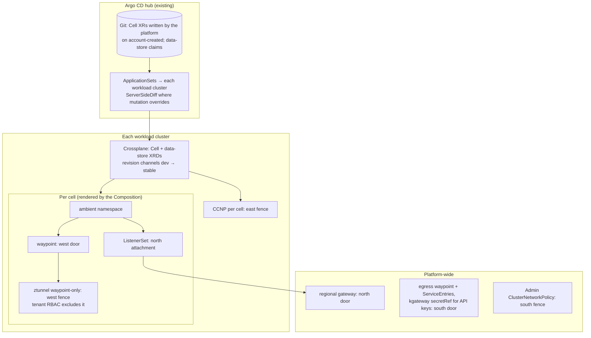

# Recommendation for a DVSP-shaped platform

Written 2026-11-16. This page synthesises [radius-in-nyt-dvsp](radius-in-nyt-dvsp.md), [openchoreo-cells-radius-crossplane](openchoreo-cells-radius-crossplane.md), [kratix-in-nyt-dvsp](kratix-in-nyt-dvsp.md), [cell-traffic-nsew-tooling](cell-traffic-nsew-tooling.md) and the hands-on [prototype-results](prototype-results.md). The platform is NYT's DVSP as described in [nytimes-dvsp-developer-platform](sources/nytimes-dvsp-developer-platform.md):

- Argo CD hub-and-spoke with ApplicationSets;
- Gatekeeper with Rego;
- a Cilium team fence and Istio ambient;
- a Kubebuilder Tenant Operator;
- one versioned Helm chart as the service contract;
- one Envoy ingress per region;
- per-team cloud accounts.

This is this write-up's assessment, not NYT's plan. Nothing here was run at NYT scale.

**The problem it answers.** "Platform changes still ride on tenant merges" (the chart's release train), plus the roadmap's data-store paved paths and "fewer custom components".

**Revision note (same day).** The first version recommended Kratix Promises over Crossplane and called Kratix's floating bindings "the only mechanism found" that pushes a platform change to every tenant. That was wrong: Crossplane's default `compositionUpdatePolicy: Automatic` does the same. Testing both on kind then favoured Crossplane (see below). The fences were also redesigned to be tenant-proof, after a lint pass noted that the first version put both fences in namespaced objects.

## Kratix vs Crossplane alone, on the evidence

Both were tested on the same kind cluster ([prototype-results](prototype-results.md), rounds 1, 2 and 4):

| | Kratix (OSS `latest`) | Crossplane 2.4.2 |
|---|---|---|
| A template change reaches every tenant, no tenant PR | Yes (floating bindings) | Yes (`Automatic`, the default) |
| Pin one tenant back | Yes; the pin is a platform-owned ResourceBinding | Yes; `Manual` + `compositionRevisionRef` on the XR |
| Staged rollout (dev first, then stable) in open source | No: SKE (paid) or a home-grown binding patcher | **Yes**: revision `channel` labels + `compositionRevisionSelector` (tested) |
| Template edit without a version bump | **Re-ran every request, pinned or floating**, within a second | **New immutable revision every edit**; pins hold |
| Procedural logic (allow-list from declared dependencies) | Any container in a pipeline | Composition function (go-templating did the `dependsOn` loop) |
| Delivery | Writes to Git per Destination; Argo CD applies (tested; ordering gap self-retries) | Renders in-cluster; Argo CD ships the XR to each cluster (tested hub → two clusters with per-environment channels) |
| Releases and governance | Rolling `latest`, no semver since 2024; not CNCF | Semver releases; CNCF graduated |
| Controllers to run | Kratix + Crossplane for cloud resources | One |

The two things Kratix does that Crossplane doesn't, Git-placed output and arbitrary container pipelines, aren't needed for the cell or for data stores. The things Crossplane does better (open-source staging, immutable revisions, versioned releases, one controller) map directly onto NYT's release-train lesson and "fewer custom components".

## Recommendation

1. **Crossplane alone as the contract layer, starting with a cluster-scoped `Cell` XR that replaces the Tenant Operator.** The platform already writes the `Tenant` into Git on the account-created event, so it writes a `Cell` XR instead, and the pins and channels on it stay platform-owned. Each environment's XRs select a revision channel (`channel: dev` in dev, `stable` elsewhere), which gives the opt-in safety valve NYT's lesson wants without a tenant merge. The cluster-scoped XR is also what lets it compose cluster-scoped fences (a namespaced v2 XR can't).
2. **Data-store XRDs in the same Crossplane**, for the roadmap's paved paths in team accounts (tested, [prototype-results](prototype-results.md) round 6). Each team namespace holds a platform-owned ProviderConfig for that team's account, and one Composition serves all teams, because namespaced MRs resolve the ProviderConfig in their own namespace. The ProviderConfig carries no team keys: one platform identity plus an `assumeRoleChain` to a role in the team account whose trust policy names only the platform. Tested on floci with IAM enforcement on: the right account received the database, and an untrusted identity got `AccessDenied`. Existing public Terraform modules (Cloud Posse, terraform-aws-modules) can sit behind the same XRDs through provider-opentofu Workspaces, with a per-team OpenTofu ProviderConfig, a `kubernetes` state backend, and `backendFile` holding only `key = value` pairs.
3. **Keep the Helm chart as the workload contract for now.** The cell (namespaces, fences, gateway attachment, egress grants) and data stores are the parts whose changes most need to reach everyone at once; the ambient migration waited on chart bumps. Revisit workloads once revision channels have run for a quarter.
4. **The fence stack (tested in all four directions), with every fence where tenants can't write it:**
   - **West:** each cell's ambient waypoint is its door. A ztunnel AuthorizationPolicy admitting only the waypoint principal is the fence. Without it, three bypasses returned 200 on kind. It must be namespaced, so make it tenant-proof with RBAC: grant tenants no write on `security.istio.io` kinds in their namespace (the built-in `admin` role doesn't include them by default), and back that with Gatekeeper. Alternatively, add a root-namespace DENY baseline.
   - **East:** a **CiliumClusterwideNetworkPolicy** per cell, generated from the cell's declared dependencies. It was tested as a drop-in for the namespaced version, and a namespace admin couldn't delete it. The destination waypoint's caller list is a second layer.
   - **North:** keep the shared regional gateway and give each public cell a ListenerSet. Set `istio.io/ingress-use-waypoint` on public cells, or the west fence returns 503 to ingress. Hostname allocation stays with the platform (Gatekeeper), because the gateway's own conflict rule is first come, first served.
   - **South:** an egress waypoint with ServiceEntries in a platform namespace, fenced by an **Admin-tier ClusterNetworkPolicy** denying direct internet egress from cell namespaces. That needs Cilium 1.20's `k8sClusterNetworkPolicy` flag (both the `v1alpha2` and the v0.3.0 `v1beta1` CRD were enforced on kind); without it, use CiliumClusterwideNetworkPolicy deny rules. The fence held after the tenant deleted its own policy, and it is the only south fence that also covers sidecar-mode workloads. Where a third party needs an API key, a kgateway egress route with a `secretRef` header does the injection (tested: injected, not forgeable, rotates without a restart).
5. **Settings that the tests showed matter:**
   - `ServerSideDiff=true` wherever Gatekeeper mutation overrides a Git-set field; otherwise the app stays OutOfSync and re-syncs forever.
   - `ignoreDifferences` on any field a controller owns.
   - A custom Argo CD health check for the Cell and Database XR kinds (tested: Progressing until Ready, then Healthy); without one Argo showed Healthy while the XR was not Ready.
   - `function-auto-ready` in every go-templating Composition, plus an explicit ready annotation on composed kinds with no Ready condition.

## Why not the others

| Option | Why not, for this platform | Evidence |
|---|---|---|
| **Kratix** (alone or above Crossplane) | Its push-to-everyone is matched by Crossplane, and Crossplane beats it on open-source staged rollout, edit safety and release governance (table above). Keep it in mind if a need appears for Git-placed output to many destinations or arbitrary container pipelines. | [kratix-in-nyt-dvsp](kratix-in-nyt-dvsp.md), [prototype-results](prototype-results.md) |
| **Radius** as the contract | A Recipe Pack change reaches only *subsequent* deployments, so the release train remains as a redeploy trigger. Its API is aggregated: a deny-all admission policy on `api.ucp.dev` let writes through on kind, so Gatekeeper wouldn't govern what tenants submit, only the objects recipes render (that half was also tested). It's Flux-only and Bicep-first. | [radius-in-nyt-dvsp](radius-in-nyt-dvsp.md), [release-propagation-openchoreo-radius-2026-11](sources/release-propagation-openchoreo-radius-2026-11.md) |
| **OpenChoreo** wholesale | It's the best conceptual fit (contract plus cells, CRD-native), but adopting it replaces the scaffolder, chart, Tenant Operator and parts of observability at once, the opposite of "fewer custom components" in migration terms. Its release model, autoDeploy to the first environment then promotion, is a train by design, and an external Argo CD must ignore `ReleaseBinding.spec.releaseName` or the two fight every 5 minutes. Its v1.3.3 code implements cells mostly as policy, with egress unrestricted. | [openchoreo-cells-radius-crossplane](openchoreo-cells-radius-crossplane.md), [cell-traffic-nsew-tooling](cell-traffic-nsew-tooling.md), openchoreo docs |
| **Mutating admission** as the glue | It fires only on create and update and creates no objects, so it can't be a release train. It's still useful for small connection wiring. Beside Argo CD it must only *add* fields, or the apps need `ServerSideDiff=true`: an override of a Git-set field stays OutOfSync under the default diff (tested). | kubernetes admission control, [prototype-results](prototype-results.md) |

## Adoption path

1. **Cell XR beside the Tenant Operator.** Render the same namespaces and policies for new tenants only, compare, then migrate existing tenants. The delivery split (ApplicationSets ship Cell XRs, each cluster's Crossplane renders them) was tested across two clusters. Set `argocd.argoproj.io/sync-options: SkipDryRunOnMissingResource=true` on XRs, or the first sync to a fresh cluster fails.
2. **Revision channels per environment.** Label each new Composition revision `dev` first and `stable` after a soak, so cells move by channel rather than all at once.
3. **Fences in report-only mode first.** Apply the waypoint-only policies cell by cell (watch for north 503s), then turn on the ClusterNetworkPolicy flag and the south deny.
4. **Data-store XRDs** for the roadmap's paved paths.
5. **Decide on workloads** once channels have run for a quarter: keep the chart, or move it behind an `App` XRD.

## Risks

- **Composition functions are now the platform's code**: go-templating, KCL or Go. The maintainers themselves call complexity an adoption blocker (crossplane).
- **Revision pins live on the XR.** That's fine while only the platform writes Cell XRs. If tenants ever author XRs, Gatekeeper must stop them editing `spec.crossplane`.
- **Cilium ClusterNetworkPolicy is flag-gated**, and its default-on date is unannounced.
- **Waypoint rate limiting has no supported API** (istio#43720), so cross-cell quotas need per-replica limits or an external rate-limit service.
- **Sidecar-mode workloads bypass the ambient egress waypoint** (tested). Until the last sidecar is gone, the Admin-tier network deny is the only south fence that covers them.
- **provider-upjet-aws sends `assumeRoleChain`'s STS call to the public STS endpoint**, ignoring the ProviderConfig endpoint. Found when it leaked placeholder-key calls from a floci test to real AWS STS. Set `AWS_ENDPOINT_URL_STS` on the provider where STS must go elsewhere, and fence provider egress in any emulator test.
- **Ambient multicluster is multi-network only**, which constrains cells that span clusters in one VPC.

## Decisions only the platform owner can make

- How many revision channels, and what soak before a revision is labelled `stable`?
- Is Crossplane per workload cluster acceptable, or should one control cluster compose remotely? The docs research ([crossplane-remote-composition-2026-11](sources/crossplane-remote-composition-2026-11.md)) shows remote composition works, but it wraps every object in a provider-kubernetes `Object`, repairs drift by polling (10 minutes by default; watches are opt-in per Object), and needs credentials per cluster. Per-cluster Crossplane repaired a deleted fence in about 10 s in the test, so it is the better default for fences.
- Is a cell a team (today's tenant) or a bounded context (WSO2's model)? That decides whether one tenant gets one Cell or several.
- Is running Cilium's flag-gated ClusterNetworkPolicy in production acceptable now, or should CCNP deny rules be used until it's default-on?

Related: [kratix-in-nyt-dvsp](kratix-in-nyt-dvsp.md), [cell-traffic-nsew-tooling](cell-traffic-nsew-tooling.md), [prototype-results](prototype-results.md), [openchoreo-cells-radius-crossplane](openchoreo-cells-radius-crossplane.md), [radius-in-nyt-dvsp](radius-in-nyt-dvsp.md), crossplane, kratix, cell based architecture, golden path, platform orchestration, [nytimes-dvsp-developer-platform](sources/nytimes-dvsp-developer-platform.md).
