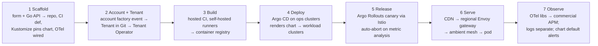

# Shared Clusters, Separate Accounts — NYT's DVSP (CNCF reference architecture)

Raw capture: `raw/cncf-nytimes-developer-platform.md` (clipped 2026-11-12). Published on the CNCF End User Community site as a reference architecture, written by NYT about itself under CC BY 4.0. That makes it a first-party primary source on the platform behind NYT's Developer Platforms org, and it reads like an ADR log more than marketing: every choice comes with the alternatives it rejected and what it cost.

**Why it matters here.** It is the most complete single description of a production internal developer platform here that names its CNCF components, and it describes the team behind the Staff Application Delivery role (offer received, declined over relocation, 2026-11-10). In this document Application Delivery owns CI, Argo CD, Argo Rollouts and the progressive-delivery paved path.

**Anonymisation.** The page names open-source projects but describes commercial products and cloud services only by category: "a managed Kubernetes service", "the cloud provider's landing zone", "a hosted CI service", "a commercial management plane for Istio". The vocabulary (cloud *accounts*, an account factory on a landing-zone service, Karpenter) fits AWS, and the evaluated NYT reqs name AWS and GCP. The page itself never names the cloud, though, so which one is primary is **UNVERIFIED** (checked: this source, company nytimes).

## The five patterns

DVSP ("originally the Delivery Engineering Shared Platform") is a fleet of managed Kubernetes clusters across environments and regions, shared by more than a hundred teams. Five patterns carry it:

1. **Two-border tenancy.** A tenant is a team: namespaces on the shared clusters *plus* the team's own dev and prod cloud accounts. See kubernetes multi tenancy.
2. **Identity, not network location.** Pods from many teams share bin-packed nodes, so an IP address identifies nobody. Authorization runs on workload identity, and network policy is "an outer fence, not a way to authenticate a caller". See zero trust.
3. **One versioned Helm chart is the contract** between a service and the platform. Each service pins a version per environment, and silence means the default.
4. **One front door per region.** Public traffic goes CDN → one shared Envoy-based ingress gateway per region → ambient mesh. Draining a region from routing evacuates it, with no cluster restore.
5. **Pre-scale on a business signal.** KEDA scales services on *news-publication events*, because "traffic can multiply within minutes, faster than new nodes start".

| At a glance | |
|---|---|
| Tenants | 100+ teams, each with a dev and a prod cloud account |
| Mesh | ~630 shared waypoint proxies in place of ~10,000 sidecars |
| Cluster upgrades | 3–4 cycles a year, each touching every cluster and 10+ components |
| Org | 13M+ subscribers, ~6,000 employees; DVSP began 2021, GA March 2023 |

## The CNCF stack, and what each piece does

| Project | Since | Role at NYT | Adoption |
|---|---|---|---|
| Kubernetes | 2021 | Managed clusters, multiple envs and regions | Established |
| Helm | 2021 add-ons; 2023 platform chart | The versioned service contract | Established |
| Argo CD / Argo Rollouts | 2022 | Hub-and-spoke GitOps sync; opt-in canaries | Established / Developing |
| Cilium | 2021 | CNI + kube-proxy replacement; network policy is the team fence | Established |
| Istio | 2021 sidecars; 2026 ambient | mTLS, identity-based authz, L7 traffic shaping | Established |
| Envoy | 2021 | Data plane of the ingress gateway and the mesh waypoints | Established |
| kgateway | 2026 | The Gateway API implementation the ingress is moving to | Emerging |
| KEDA | 2024 | Event pre-scaling on news publication, cron and queue scaling, alongside the HPA | Developing (opt-in) |
| Karpenter | — | Node provisioning, spot + on-demand mix (a SIG Autoscaling subproject) | Established |
| OPA / Gatekeeper | 2022 | Admission policy in Rego | Established |
| OpenTelemetry | 2022 | Wrapper libraries (Go, Node.js, Python, JVM): SDK config, W3C trace context + baggage, OTLP export | Developing (required for backends) |
| SPIFFE | — | The identity format inside mesh certificates | Developing |
| Kubebuilder | 2021 | Framework for the in-house Tenant Operator | Established |

Non-CNCF supporting cast: Renovate (chart-upgrade PRs), Kustomize (renders the chart per repo, with room for patches), an IaC tool plus a managed build service (cluster, add-on and account baselines), a secrets manager with a Kubernetes operator, managed queues (KEDA's scale sources), a commercial observability platform and a separate log service, and a CDN.

## How a service travels the platform

## Mechanisms worth stealing

- **Onboarding is an event, not a ticket.** The account factory emits an *account-created* event. The platform answers by writing a `Tenant` into Git, and the Kubebuilder Tenant Operator reconciles it into namespaces, access and policy in every environment. Tenants self-serve extra namespaces through a `Space` resource, which inherits the tenant's config. The first design mapped one tenant to one namespace, and "more namespaces per tenant turned out to be one of the features beta tenants asked for most". Pattern: kubernetes operators as the tenancy engine, gitops as its input.
- **Cost follows the borders.** Anything in a team's accounts bills to that team with no tagging. Shared cluster capacity and platform overhead are reallocated by CPU usage, keyed on a tenant pod label, and idle capacity is reported as its own line. Compare OpenCost's allocation model.
- **The chart as a versioned contract.** It is published to an artifact registry, semver'd, and pinned per environment through a Kustomize `helmCharts` entry. A Kustomize patch is the deliberate escape hatch. From a short values file the chart renders the Deployment or Rollout, Service, autoscaling, ingress route, a PodDisruptionBudget and default alerts. The defaults are three replicas spread across AZs. Renovate opens the upgrade PRs, and teams merge them like any dependency bump. Owned InnerSource-style: a core team owns the chart and its release process, and feature teams maintain their templates through code-owner rules (Application Delivery owns the Rollouts templates).
- **Argo CD out of the request path.** Hub-and-spoke on dedicated operations clusters, tenant apps generated from ApplicationSets, automated sync with prune and self-heal recommended. "If it stopped, running services would keep serving, and only changes would stop."
- **Canary that gates itself.** `rollout.enabled` makes the chart render a Rollout that references the Deployment and shifts weights on an Istio VirtualService. Analysis checks error rate, restarts and OOM kills, and a failing run aborts the canary with no human involved. The default strategy is one 100% step. "Some teams now treat a canary that aborts on its own as a stronger release gate than a pre-deploy test." See progressive delivery.
- **Baggage-routed PR environments.** Each open PR can run as an ephemeral deployment in dev. A request carries a W3C `baggage` header naming services and their PRs, and chart-rendered VirtualService rules route each named hop to its PR build. This works only because the OTel wrapper libraries propagate baggage on every call, so testing a three-service change "does not need a copy of everything else". Limited to dev.
- **Upgrades as one-cluster PRs.** Each PR changes one cluster, so it has one blast radius. Order: compatibility add-ons, then control plane, then node images, phased across environments with soaks in between. Add-ons are applied in dependency order (cloud resources via IaC, then Helm charts, then Kustomize overlays). **An AI coding agent researches each upgrade, cross-checks component compatibility and opens the PRs; it never merges.** That is a concrete case of "agents as platform users" (compare platform engineering § agents as a second platform consumer).

## Decisions and the alternatives they beat

| Decision (year) | Chose | Rejected | Why |
|---|---|---|---|
| Cloud (2021) | One public cloud | Multi-cloud from day one | Centralise shared capabilities; recorded as a strategy bet in 2022 |
| Clusters (2021) | Small fleet of shared managed clusters | A cluster per team (the status quo: "hundreds of small, differently configured" clusters) | Each needed its own upgrades and security fixes |
| Tenant border (2020–21) | Account pair per team from an account factory | One shared account; unmanaged per-team accounts | Shared account meant every boundary needed central review |
| Tenant controller (2021–22) | In-house Tenant Operator on Kubebuilder | IaC-template tenants; Operator Framework / plain client-go; **Capsule and kiosk** (listed as references) | Per-tenant policy needs continuous reconciliation; Kubebuilder's docs, SIG API Machinery home, team familiarity |
| Runtime (2022) | Kubernetes first, stateless first | Serverless as primary | Ecosystem breadth |
| CNI (2021) | Cilium replacing the provider's default | Calico (security team tested it first) | Lower policy latency, finer policy, better pod-network performance, friendlier docs |
| Pod addressing (2022) | VPC-routable pod IPs from a secondary range | Overlay network | A managed control plane outside the cluster network cannot reach overlay pod IPs, **which breaks admission webhooks** |
| Admission (2021) | Gatekeeper (OPA) | Kyverno | Policy in Rego |
| GitOps (2022) | Argo CD | Flux; push deploys from CI; a cloud deploy service | Push gave CI no view of declared state or drift; Argo's UI, SSO and notifications suit a many-team platform |
| Progressive delivery (2022) | Argo Rollouts | Flagger (with Flux) | A Rollout looks like a Deployment, shapes traffic through Istio, analyses own metrics |
| App contract (2023–24) | Versioned Helm chart via Kustomize | Per-repo YAML from templates; **OAM/KubeVela**; Knative | Per-repo YAML made every team learn Kubernetes config, and platform features meant hand-editing every repo's overlays |
| Breaking-news capacity (2025) | KEDA pre-scaling on publication events | Reactive autoscaling only | Spikes outrun node start-up |
| Mesh (2025) | Istio ambient via a commercial management plane | Stay on sidecars; self-managed OSS Istio | Sidecars took ~⅓ of production CPU; self-managing meant building multi-cluster mgmt, policy and observability |

**What ambient mode bought (NYT's numbers, not rerun here).** The mesh's share of production CPU fell from ~⅓ to under 7%. ~10,000 sidecars became ~630 waypoints and ~9,400 cores were freed. A staging load test at 100k rps put p99 latency on a high-throughput GraphQL service at ~191 ms with sidecars and 3–5 ms with ambient after tuning. NYT credits the CPU gain to ambient itself (no per-pod proxies), not to the vendor plane. The vendor goes unnamed. Solo.io's Gloo Mesh is one commercial Istio-ambient management plane in this write-up, but nothing in this source says it is NYT's (**UNVERIFIED**).

## What didn't work (the most reusable section)

- **Platform changes still ride on tenant merges.** The chart freed teams from YAML but not from the release train. Ambient needed every service on a newer chart, and Renovate shortens that wait without removing it. Lesson: "A paved path is a product with a release train" (platform as a product).
- **The values file became the new YAML.** One chart now covers ingress, mesh, autoscaling, rollouts, secrets, alerts, PR envs and cron jobs, so it is a large surface to learn. Anything it doesn't expose, such as fixed label selectors, needs a Kustomize patch. See team cognitive load.
- **Ambient is density-sensitive.** ztunnel carries every mesh pod's traffic on its node, so it must be sized for the *densest* pool. NYT pins node sizes, reserves capacity for node agents, taints new nodes until the mesh is ready, and rolls out in soaked stages.
- **Autoscalers don't coordinate.** KEDA acts in seconds. Karpenter consolidates on a slower cycle *based on requests, not usage*, so pods with requests far below limits make busy nodes look idle and invite consolidation under load. Levers: requests closer to peak use, consolidation limits while pre-scaled, and a pre-stop delay in the chart for clean scale-in. Lesson: "Pod autoscaling, node autoscaling and consolidation form one control system; tuned separately, they fight" (kubernetes autoscaling).
- **Shared clusters need shared manners.** Tenant PodDisruptionBudgets can stall drains, so Karpenter node pools carry a termination grace period. Cluster-wide agents scale with pod *churn*, not traffic. And the node autoscaler resolves DNS through the cloud resolver, not cluster DNS, because it has to start on a cold cluster whose DNS runs on nodes it provisions.
- **Migration help doesn't scale.** Paired migrations drove adoption more than anything but eat senior time. Stateful and serverless services need new paved paths, not more help.
- **Shared ownership erodes.** "Shared libraries that everyone is meant to own tend to end up with no owner." Hence the chart's core-team-plus-code-owners model.

## Teams (Team Topologies applied, in their words)

Five teams in Developer Platforms each offer their layer as a service: **Engagements** (scaffolder + migration partnerships; senior-heavy, "both an enabling team and a platform team"), **Cloud Engineering** (account factory, cluster fleet), **Application Delivery** (CI, Argo CD/Rollouts, the progressive-delivery paved path), **Edge Platforms** (CDN, ingress gateway) and **SRE** (observability standards, load testing, cost visibility). Product teams are stream-aligned and own on-call. The platform meets them in all three team topologies interaction modes: X-as-a-service by default (scaffolder, chart, docs, office hours, changelog, plus an AI assistant in the support channel that answers from docs and routes the rest by component ownership), collaboration for migrations (from 2023, "teach rather than carry"), and facilitation for tenant-affecting changes (runbook plus help for laggards).

## Journey

2020 account factory → 2021 two borders agreed with security; first clusters with Cilium, Istio, Envoy ingress → 2022 strategy bets recorded (one cloud, K8s first, central ingress, accounts as tenancy, stateless first); Tenant Operator replaces template tenants; Argo CD + Rollouts chosen → 2023 GA (March) → 2024 the chart becomes the default contract, with InnerSource ownership → 2025 canary analysis in the chart, KEDA pre-scaling, OTel required → 2026 ambient-mode migration; focus shifts from migrating services to deepening the platform.

**Next:** finish the ingress move to Gateway API on kgateway; serverless and data-store paved paths; a platform-wide scale-up control; and fewer custom components, weighing managed cloud options against "Cilium's flow visibility and application-layer policy".

## Where it agrees and disagrees with the rest of this write-up

- **Helm as the contract vs Farcic's "ditch Helm for your own abstractions."** Farcic (Apr 2025) argues a team's own abstractions belong in CRDs plus controllers, not templates. NYT explicitly weighed a higher-level model (OAM/KubeVela) and Knative, then chose a versioned Helm chart in 2023–24. NYT's own "values file became the new YAML" finding is, though, the cost Farcic predicts (`helm show values` is "not a 'real' schema"). The two converge on the problem and differ on the remedy; flagged on helm.
- **Sidecars.** This write-up's sidecar pattern page presents the mesh sidecar as Burns's pattern working as intended. NYT's production data says the per-pod proxy cost about a third of production CPU and added two proxy hops per call. That doesn't contradict the pattern, but at scale it is the strongest evidence in this write-up *against* sidecars as mesh substrate. Flagged on sidecar pattern and istio.
- **Gatekeeper over Kyverno, in 2021.** This write-up's kubernetes admission control page records a 2025 shift toward in-tree CEL policies. NYT's Rego choice predates that, and the source doesn't say whether they revisited it.
- **Backstage absent.** The front door is a home-built scaffolder (form + Go API), not Backstage. Compare the internal developer portal page: the portal is optional; the golden path is not.

## Key lessons (verbatim headings, condensed)

Draw the tenant border where ownership already is, and agree it in writing with security *before* writing a controller · On shared nodes network location is not a trustworthy signal · A paved path is a product with a release train · Operations after launch are the platform: staff for upgrades before features · Test infra changes at production density · Couple autoscalers on purpose · A shared front door needs burst isolation · Opt-in resilience protects only the services that opt in · Plan for replacements: the replacement needs a way to reach already-running services.

**Follow-up: would Radius fix the chart's release train? (2026-11-12)** [Radius in a DVSP-shaped platform](../radius-in-nyt-dvsp.md) maps each "what has not worked" item against Radius v0.62. It mostly solves the tenant-merge release train (though a pack change reaches running apps only on redeploy, checked 2026-11-16) and fits NYT's own "data-store paved paths" next step, but today costs Argo CD (Flux-only GitOps), Gatekeeper visibility (aggregated API), and an incremental migration path (Helm annotations removed in v0.61).

## Cross-links

company nytimes · cncf · platform engineering · platform as a product · golden path · kubernetes multi tenancy · service mesh · istio · cilium · envoy · kgateway · gateway api · kubernetes ingress · helm · kustomize · renovate · argo cd · argo rollouts · flux · gitops · progressive delivery · keda · karpenter · horizontal pod autoscaler · kubernetes autoscaling · open policy agent · kyverno · kubernetes admission control · kubernetes network policy · opentelemetry · spiffe spire · service identity · zero trust · kubebuilder · kubernetes operators · team topologies · team cognitive load · sidecar pattern · internal developer portal · backstage · company solo io.

**Follow-up: what to adopt (2026-11-16)** [Recommendation for a DVSP-shaped platform](../recommendation.md) draws the Radius, OpenChoreo, Crossplane and Kratix comparisons and a kind prototype into one decision: Crossplane alone (a platform-written Cell XR with revision channels), after testing it beside Kratix, with a tenant-proof fence stack for all four cell traffic directions.
