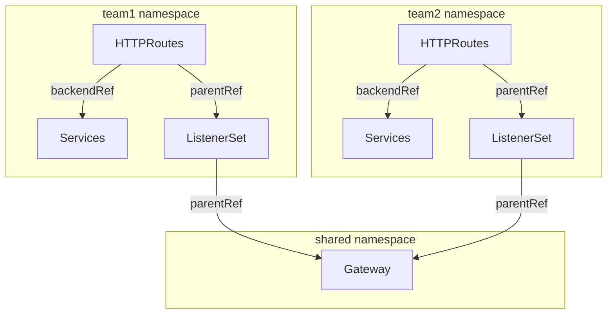

<!-- ===== site/content/en/.../security.md ===== -->

---
title: "Security"
weight: 25
---

## Introduction
Gateway API has been designed to enable granular authorization for each role in
a typical organization.

## Resources
Gateway API has 3 primary API resources:

* **GatewayClass** defines a set of gateways with a common configuration and
  behavior.
* **Gateway** requests a point where traffic can be translated to Services
  within the cluster.
* **Routes** describe how traffic coming via the Gateway maps to the Services.

## Roles and personas

There are 3 primary roles in Gateway API, as described in [roles and personas]:

- **Ian** (he/him): Infrastructure Provider
- **Chihiro** (they/them): Cluster Operator
- **Ana** (she/her): Application Developer

[roles and personas]: /docs/concepts/roles-and-personas/

### RBAC

RBAC (role-based access control) is the standard used for Kubernetes
authorization. This allows users to configure who can perform actions on
resources in specific scopes. RBAC can be used to enable each of the roles
defined above. In most cases, it will be desirable to have all resources be
readable by most roles, so instead we'll focus on write access for this model.

#### Write Permissions for Simple 3 Tier Model
| | GatewayClass | Gateway | Route |
|-|-|-|-|
| Infrastructure Provider | Yes | Yes | Yes |
| Cluster Operators | No | Yes | Yes |
| Application Developers | No | No | Yes |

#### Write Permissions for Advanced 4 Tier Model
| | GatewayClass | Gateway | Route |
|-|-|-|-|
| Infrastructure Provider | Yes | Yes | Yes |
| Cluster Operators | Sometimes | Yes | Yes |
| Application Admins | No | In Specified Namespaces | In Specified Namespaces |
| Application Developers | No | No | In Specified Namespaces |

## Crossing Namespace Boundaries
Gateway API provides new ways to cross namespace boundaries. These
cross-namespace capabilities are quite powerful but need to be used carefully to
avoid accidental exposure. As a rule, every time we allow a namespace boundary
to be crossed, we require a handshake between namespaces. There are 2 different
ways that can occur:

### 1. Route Binding
Routes can be connected to Gateways in different namespaces. To accomplish this,
The Gateway owner must explicitly allow Routes to bind from additional
namespaces. This is accomplished by configuring allowedRoutes within a Gateway
listener to look something like this:

```yaml
namespaces:
  from: Selector
  selector:
    matchExpressions:
    - key: kubernetes.io/metadata.name
      operator: In
      values:
      - foo
      - bar
```

This will allow routes from the "foo" and "bar" namespaces to attach to this
Gateway listener.

#### Risks of Other Labels
Although it's possible to use other labels with this selector, it is not quite
as safe. While the `kubernetes.io/metadata.name` label is consistently set on
namespaces to the name of the namespace, other labels do not have the same
guarantee. If you used a custom label such as `env`, anyone that is able to
label namespaces within your cluster would effectively be able to change the set
of namespaces your Gateway supported.

### 2. ReferenceGrant
There are some cases where we allow other object references to cross namespace
boundaries. This includes Gateways referencing Secrets and Routes referencing
Backends (usually Services). In these cases, the required handshake is
accomplished with a ReferenceGrant resource. This resource exists within a
target namespace and can be used to allow references from other namespaces.

For example, the following ReferenceGrant allows references from HTTPRoutes in
the "prod" namespace to Services that are deployed in the same namespace as
the ReferenceGrant.



For more information on ReferenceGrant, refer to our [detailed documentation
for this resource](/reference/api-types/referencegrant/).

## Security considerations

Gateway controllers can be deployed in a multi-tenant environment, where different
namespaces are used by different users and customers.

Some caution should be taken by the cluster administrators and Gateway owners to
provide a safer environment.

### Avoiding hostname/domain hijacking

On Gateway API, it is possible for distinct Routes and ListenerSets to claim the same hostname. 
Gateway controllers are responsible for the conflict resolution, that usually works on a first-come, first-served basis, where the first created resource wins in the  conflict management.

The [hostname definition](/reference/api-spec/main/spec/#httproutespec) on a Route or on ListenerSet is a list, and given the following scenario:

* `Gateway` accepts routes from a set of namespaces
* `HTTPRoute` with name `route1` is created on namespace `ns1`, with `creationTimestamp: 00:00:01`
and defines hostname `something.tld`.
* `HTTPRoute` with name `route2` is created on namespace `ns2`, with `creationTimestamp: 00:00:30`
and defines hostname `otherthing.tld`.

If the owner of `route1` adds later `otherthing.tld` to the list of hostnames, the 
route will be hijacked from `route2` because `route1` is older.

To avoid this situation, the following actions should be taken:

* On Gateways, admins SHOULD ensure that hostnames are clearly delegated to a specific namespace or set of namespaces:


{}
```yaml
apiVersion: gateway.networking.k8s.io/v1
kind: Gateway
metadata:
  name: gateway
spec:
  gatewayClassName: some-class
  listeners:
  - hostname: "something.tld"
    name: listener1
    port: 80
    protocol: HTTP
    allowedRoutes:
      namespaces:
        from: Selector
        selector:
          matchLabels:
            kubernetes.io/metadata.name: ns1
  - hostname: "otherthing.tld"
    name: listener2
    port: 80
    protocol: HTTP
    allowedRoutes:
      namespaces:
        from: Selector
        selector:
          matchLabels:
            kubernetes.io/metadata.name: ns2
```
{}
{}
```yaml
apiVersion: gateway.networking.k8s.io/v1
kind: Gateway
metadata:
  name: gateway
spec:
  gatewayClassName: some-class
  listeners:
  - name: listener1
    port: 80
    protocol: HTTP
    allowedRoutes:
      namespaces:
        from: All
```
{}


#### More than 64 listeners

Gateway resource has a limitation of 64 listener entries. If you need more than 64
listeners, you should consider allowing your users to set their hostnames directly
on the routes of each namespaces but limiting what namespace can use what hostname
by relying on a mechanism like `ValidatingAdmissionPolicy`.

In case you opt to use `ListenerSet`, a similar mechanism
should also be considered to limit what hostnames a `ListenerSet` can claim.

#### Example of a ValidatingAdmissionPolicy

A [ValidatingAdmissionPolicy](https://kubernetes.io/docs/reference/access-authn-authz/validating-admission-policy/)
can be used to add rules that limits what namespaces can use what domains. 

{}
The validation policy shown here **IS AN EXAMPLE** and the cluster-admin should do
adjustments to their own environment! Do not copy/paste this example without proper
adjustments

{}
The policy exemplified here will:

* Read the allowed domains from a comma-separated value of the `annotation` "domains" present on the namespace.
* Validate if all of the hostnames within `.spec.hostnames` are contained on this annotation.
* In case any of the entries are not authorized, the policy denies its admission.

```yaml
apiVersion: admissionregistration.k8s.io/v1
kind: ValidatingAdmissionPolicy
metadata:
  name: httproute-hostname-policy
spec:
  failurePolicy: Fail
  matchConstraints:
    resourceRules:
    - apiGroups: ["gateway.networking.k8s.io"]
      apiVersions: ["v1", "v1beta1"]
      operations: ["CREATE", "UPDATE"]
      resources: ["httproutes"]
  variables:
  - name: allowed_hostnames_str
    expression: |
      has(namespaceObject.metadata.annotations) && 
      has(namespaceObject.metadata.annotations.domains) ?
      namespaceObject.metadata.annotations['domains'] : '' 
  - name: allowed_hostnames_list
    expression: |
      variables.allowed_hostnames_str.split(',').
      map(h, h.trim()).filter(h, size(h) > 0)
  validations:
  - expression: |
      !has(object.spec.hostnames) || 
      size(object.spec.hostnames) == 0 || 
      object.spec.hostnames.all(hostname, hostname in variables.allowed_hostnames_list)
    message: "HTTPRoute validation failed. It contains unauthorized hostnames"
---
apiVersion: admissionregistration.k8s.io/v1
kind: ValidatingAdmissionPolicyBinding
metadata:
  name: httproute-hostname-binding
spec:
  policyName: httproute-hostname-policy
  validationActions: ["Deny"]
  matchResources:
    namespaceSelector: {}
```

Once the policy is created, the cluster-admin should explicitly allow the usage of
domains with a command like `kubectl annotate ns default domains=www.dom1.tld,www.dom2.tld`

Additionally, when dealing with environments that provide DNS record creations,
admins should be aware and limit the DNS creation based on the same constraints above.

### Limiting Cross-Namespace References

Owners of resources should be aware of the usage of [ReferenceGrants](/reference/api-types/referencegrant/).

ReferenceGrant allows resource owners to make their resources available to
Gateway API resources in other namespaces. It may be beneficial to restrict where
this can be done.

A `ValidatingAdmissionPolicy` can be used to limit what kind of `resource` and which `namespace`
can create a `ReferenceGrant`.

Below is an **EXAMPLE** that can be used to limit the usage of a `ReferenceGrant` just 
on namespaces labeled with `referencegrants=allow` and only allowing objects of kind `HTTPRoute`
to reference an object of kind `Service` that MUST have a name:

```yaml
apiVersion: admissionregistration.k8s.io/v1
kind: ValidatingAdmissionPolicy
metadata:
  name: reference-grant-limit
spec:
  failurePolicy: Fail
  matchConstraints:
    resourceRules:
    - apiGroups: ["gateway.networking.k8s.io"]
      apiVersions: ["v1", "v1beta1"]
      operations: ["CREATE", "UPDATE"]
      resources: ["referencegrants"]
  variables:
  - name: allowed_grant_ns
    expression: |
      has(namespaceObject.metadata.labels) && 
      has(namespaceObject.metadata.labels.referencegrants) &&
      namespaceObject.metadata.labels['referencegrants'] == 'allow' 
  - name: allowed_from_kind
    expression: |
      object.spec.from.all(f, f.kind=='HTTPRoute')
  - name: allowed_to_kind
    expression: |
      object.spec.to.all(t, t.kind == 'Service' && has(t.name) && t.name != '')
  validations:
  - expression: |
      variables.allowed_grant_ns && variables.allowed_from_kind && variables.allowed_to_kind
    message: "ReferenceGrant must be explicitly allowed on the namespace, from an HTTPRoute to a named service"
---
apiVersion: admissionregistration.k8s.io/v1
kind: ValidatingAdmissionPolicyBinding
metadata:
  name: reference-grant-limit
spec:
  policyName: reference-grant-limit
  validationActions: ["Deny"]
  matchResources:
    namespaceSelector: {}
```

ReferenceGrant owners should ensure that the reference permissions being granted are as minimal as possible.

* Specify `to` targets in all possible ways (`group`, `kind`, **and** `name`)  
* In particular, DO NOT leave `name` unspecified, even though it is optional, without a *very* good reason, as that is granting a blanket 

### Proper definition of Roles and RoleBinding

The creation of a new Gateway should be considered as a privileged permission.
The unguarded creation of Gateways may increase costs, infrastructure modifications
(like a LoadBalancer and a DNS record creation) and as in such case, admins should
be aware of it and create [Roles](https://kubernetes.io/docs/reference/access-authn-authz/rbac/#role-and-clusterrole) 
and [RoleBindings](https://kubernetes.io/docs/reference/access-authn-authz/rbac/#rolebinding-and-clusterrolebinding) 
that reflect proper user permissions.

Additionally, it is highly recommended that the strict permissions are given, not
allowing regular users to modify a Gateway API status.

### Usage and limit of GatewayClass

A cluster may have different GatewayClasses, with different purposes. As an example,
one GatewayClass may enforce that Gateways attached to it can only use internal load balancers.

Cluster admins should be aware of these requirements, and define validation
policies that limit the improper attachment of a Gateway to a GatewayClass by unauthorized users.

A [ValidatingAdmissionPolicy](https://kubernetes.io/docs/reference/access-authn-authz/validating-admission-policy/)
can be used to limit what namespaces can use a `GatewayClass`.

<!-- ===== site/content/en/.../multiple-ns.md ===== -->

---
title: "Cross-Namespace routing"
weight: 12
---

Gateway API has core support for cross Namespace routing. This is useful
when more than one user or team is sharing the underlying networking
infrastructure, yet control and configuration must be segmented to minimize
access and fault domains.

Gateways and Routes can be deployed into different Namespaces and Routes  can
attach to Gateways across Namespace boundaries. This allows user access
control to be applied differently across Namespaces for Routes and Gateways,
effectively segmenting access and control to different parts of the
cluster-wide  routing configuration. The ability for Routes to attach to
Gateways across Namespace boundaries are governed by [_Route Attachment_](#cross-namespace-route-attachment). Route attachment is explored
in this guide and demonstrates how independent teams can safely share the same
Gateway.

In this guide there are two independent teams, _store_ and _site_, operating
in the same Kubernetes cluster in the `store-ns` and `site-ns` Namespaces. These
are their goals and how they use Gateway API resources to accomplish them:

- The site team has two applications, _home_ and _login_. The team wants to to
isolate access and  configuration across their apps as much as possible to
minimize access and failure domains. They use separate HTTPRoutes attached to
the same Gateway to isolate routing configurations, such as canary rollouts,
but still share the same IP address, port, DNS domain, and TLS certificate.
- The store team has a single Service called _store_ that they have deployed
in the `store-ns` Namespace which also needs to be exposed behind the same IP
address and domain.
- The Foobar Corporation operates behind the `foo.example.com` domain for all
apps. This is controlled by a central infrastructure team, operating in the
`infra-ns` Namespace.
- Lastly, the security team controls the certificate for `foo.example.com`.
By managing this certificate through the single shared Gateway they are able
to centrally control security without directly involving application teams.

The logical relationship between Gateway API resources looks like this:


## Cross-namespace Route Attachment

[Route attachment][attachment] is an important concept that dictates how Routes
attach to Gateways and program their routing rules. It is especially relevant
when there are Routes across Namespaces that share one or more Gateways.
Gateway and Route attachment is bidirectional - attachment can only succeed if
the Gateway owner and Route owner both agree to the relationship. This
bi-directional relationship exists for two reasons:

- Route owners don't want to overexpose their applications through paths they
are not aware of.
- Gateway owners don't want certain apps or teams using Gateways without
permission. For example, an internal service shouldn't be accessible
through an internet Gateway.

Gateways support _attachment constraints_ which are fields on Gateway
listeners that restrict which Routes can be attached. Gateways support
Namespaces and Route types as attachment constraints. Any Routes that do not
meet the attachment constraints are not able to attach to that Gateway.
Similarly, Routes explicitly reference Gateways that they want to attach to
through the Route's `parentRef` field. Together these create a handshake
between the infra owners and application owners that enables them to
independently define how applications are exposed through Gateways. This is
effectively a policy that reduces administrative overhead. App owners can
specify which Gateways their apps should use and infra owners can constrain
the Namespaces and types of Routes that a Gateway accepts.


## Shared Gateway

The infrastructure team deploys the `shared-gateway` Gateway into the `infra-ns`
Namespace:



The `https` listener in the above Gateway matches traffic for the
`foo.example.com` domain. This allows the infrastructure team to manage all
aspects of the domain. The HTTPRoutes below do not need to specify domains
and will match all traffic by default if `hostname` is not set. This makes
it easier to manage HTTPRoutes because they can be domain agnostic, which is
helpful when application domains are not static.

This Gateway also configures HTTPS using the `foo-example-com` Secret
in the `infra-ns` Namespace. This allows the infrastructure team to centrally
manage TLS on behalf of app owners. The `foo-example-com` certificate will
terminate all traffic going to its attached Routes, without any TLS
configuration on the HTTPRoutes themselves.

This Gateway uses a Namespace selector to define which HTTPRoutes are allowed
to attach. This allows the infrastructure team to constrain who
or which apps can use this Gateway by allowlisting a set of Namespaces.


```yaml
apiVersion: gateway.networking.k8s.io/v1
kind: Gateway
spec:
  listeners:
  - allowedRoutes:
      namespaces:
        from: Selector
        selector:
          matchLabels:
            shared-gateway-access: "true"
...
```

_Only_ Namespaces which are labelled `shared-gateway-access: "true"` will be
able to attach their Routes to `shared-gateway`. In the following set of
Namespaces, if an HTTPRoute existed in the `no-external-access` Namespace with
a `parentRef`  for `infra-ns/shared-gateway`, it would be ignored by the
Gateway because the  attachment constraint (Namespace label) was not met.



Note that attachment constraints on the Gateway are not required, but they are
a best-practice if operating a cluster with many different teams and
Namespaces. In environments where all apps in a cluster have permission to
attach to a Gateway then the `listeners[].allowedRoutes` field does not have to be
configured and all Routes can freely use the Gateway.


## Route Attachment

The store team deploys their route for the `store` Service in the `store-ns`
Namespace:



This Route has straightforward routing logic as it just matches for
`/store` traffic which it sends to the `store` Service.

The site team now deploys Routes for their applications. They deploy two
HTTPRoutes into the `site-ns` Namespace:

- The `home` HTTPRoute acts as a default routing rule, matching for all traffic
to `foo.example.com/*` not matched by an existing routing rule and sending it to
the `home` Service.
- The `login` HTTPRoute  routes traffic for `foo.example.com/login` to
`service/login-v1` and `service/login-v2`. It uses weights to granularly
control traffic distribution between them.

Both of these Routes use the same Gateway attachment configuration which
specifies `gateway/shared-gateway` in the `infra-ns` Namespace as the only
Gateway that these Routes want to attach to.



After these three Routes are deployed, they will all be attached to the
`shared-gateway` Gateway. The Gateway merges these Routes into a single flat
list of routing rules. [Routing precedence](/reference/api-spec/main/spec/#httprouterule)
between these routing rules is determined by most specific match and
conflicts are handled according to [conflict
resolution](/guides/api-design/#conflicts). This provides predictable and
deterministic merging of routing rules between independent users.

Thanks to cross-Namespace routing, the Foobar Corporation can distribute
ownership of their infrastructure more evenly, while still retaining centralized
control. This gives them the best of both worlds, all delivered through
declarative and open source APIs.

[attachment]: /docs/concepts/api-overview/#attaching-routes-to-gateways

<!-- ===== site/content/en/.../listener-set.md ===== -->

---
title: "ListenerSet"
weight: 19
---


This feature is part of extended support. For more information on support levels, refer to our [conformance guide](/docs/concepts/conformance/).



ListenerSets allow teams to define ports, hostnames, and TLS certificates in separate resources
rather than cramming everything into one giant Gateway object which has a limit of 64 listeners.
This enables a delegated management model suitable for high-scale, multi-tenant environments.

As such, you might use ListenerSets for the following advantages:

- *Multitenancy*: You can let different teams create their own ListenerSets while sharing the same
Gateway and backing load-balancing infrastructure.

- *Large scale deployments*: By using ListenerSets, Gateways can have more than 64 listeners attached.
Teams can also share the same ListenerSet configuration to avoid duplication.

- *Certificates for more listeners per gateway*: Because you can now have more than 64 listeners per Gateway,
a single Gateway can forward secured traffic to more backends that might have their own certificates.
This approach aligns with projects that require service-level certificates, such as Istio Ambient Mesh or Knative.

The following diagram illustrates how ListenerSets help decentralize route configuration in a multi-tenant environment:

- Team 1 and Team 2 each manage their own Service and HTTPRoute resources within their respective namespaces.

- Each HTTPRoute refers to a namespace-local ListenerSet. This way, each team controls how their routes are exposed,
such as the protocol, port, and TLS certificate settings.

- The ListenerSets from both teams share a common Gateway in a separate namespace. A separate Gateway team can setup
and manage centralized infrastructure or enforce policies as appropriate.



## Using ListenerSets
### Gateway Configuration

By default, a Gateway does not allow ListenerSets to be attached. Users can enable this behaviour
by configuring their Gateway to allow ListenerSets by adding the `allowedListeners` field to the Gateway spec.
This defines which namespaces are permitted to contribute listeners.

```yaml
apiVersion: gateway.networking.k8s.io/v1
kind: Gateway
metadata:
  name: parent-gateway
spec:
  allowedListeners:
    namespaces:
      from: Same
```

### ListenerSet Configuration
The ListenerSet references the parent Gateway via `parentRef`:

```yaml
apiVersion: gateway.networking.k8s.io/v1
kind: ListenerSet
metadata:
  name: workload-listeners
spec:
  parentRef:
    name: parent-gateway
    kind: Gateway
    group: gateway.networking.k8s.io
```

### Route Attachment

To attach an `HTTPRoute` (or any other route type) to a ListenerSet,
it must reference the `ListenerSet` as the Parent Resource via `parentRefs`.

```yaml
apiVersion: gateway.networking.k8s.io/v1
kind: HTTPRoute
metadata:
  name: httproute-example
spec:
  parentRefs:
  - name: workload-listeners
    kind: ListenerSet
    group: gateway.networking.k8s.io
    sectionName: second
```

## Listener Conflicts

Since multiple ListenerSets can attach to one Gateway, there are rules about how to manage conflicts.
A Listener can be **distinct** across any group of Listeners (within a single ListenerSet object, or in the group of Listeners attached to a Gateway) based on the combination of Port, Protocol, and (depending on the Protocol) Hostname.

When Listeners are not distinct, there are Listener precedence rules that are used to choose a is used to resolve the conflict, and choose which Listener takes effect. It's often easiest to think of this as a competition, with the "winner" being the Listener that takes effect. The rules go like this, continuing on ties.

* Listeners on the parent Gateway take priority over all others.
* The ListenerSet with the earliest creation time takes priority.
* The first ListenerSet alphabetically takes priority.
 
The winning ListenerSet is marked as `Accepted: true`, and the losing ListenerSet(s) are marked with `Accepted: false`, and `Conflicted: true`.

As with all the other conflict resolution rules in Gateway API, this is intended to provide traffic stability - so adding a new, conflicting ListenerSet will never take over an existing config.

## Examples

The following example shows a `Gateway` with an HTTP listener and two child HTTPS `ListenerSets` with unique hostnames and certificates. Only `ListenerSets` in namespaces that have the `belongs-to: shared-gateway` label will be accepted:


