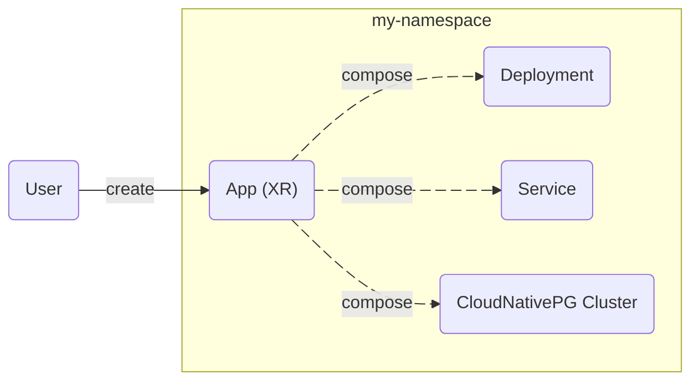

## content/v2.4/whats-new/_index.md lines 7-19, 55-60, 105-115, 179-216
opinionated.**

Crossplane v2 makes four major changes:

* **Composite resources are now namespaced**
* **Managed resources are now namespaced**
* **Composition supports any Kubernetes resource**
* **Operations enable operational workflows**

**Crossplane v2 is better suited to building control planes for applications,
not just infrastructure.** It removes the need for awkward abstractions like
claims and provider-kubernetes Objects.

...
## Namespaced composite resources

Crossplane v2 makes composite resources (XRs) namespaced by default.

A namespaced XR can compose any resource ([not just Crossplane resources](#compose-any-resource))
in its namespace.
...
    plural: apps
  versions:
  - name: v1
  # Removed for brevity
```

You can also set the `scope` field to `Cluster` to create a cluster scoped XR. A
cluster scoped XR can compose any cluster scoped resource. A cluster scoped XR
can also compose any namespaced resource in any namespace.

With namespaced XRs there's no longer a need for claims. **The new namespaced
...
## Compose any resource

Crossplane v2 isn't opinionated about using composition together with managed
resources.

You can create a composite resource (XR) that composes any resource, whether
it's a Crossplane MR like an `RDSInstance`, a Kubernetes resource like a
`Deployment`, or a third party custom resource like a
[CloudNativePG](https://cloudnative-pg.io) PostgreSQL `Cluster`.



This opens composition to exciting new use cases - for example building custom
app models with Crossplane.


You must grant Crossplane access to compose resources that aren't Crossplane

## content/v2.4/composition/compositions.md lines 280-295
to create the composed resources that a function pipeline returns.

Crossplane's service account has access to create, update, and delete any
resource installed by a [provider](), or
defined by an XRD. This includes all
[MRs]() and
[XRs](). It also has access to some types of
Kubernetes resources that it needs to function - for example it can create
deployments.

You must grant Crossplane access to compose any other kind of resource. You do
this by creating an [RBAC ClusterRole](https://kubernetes.io/docs/reference/access-authn-authz/rbac/).

<!-- vale write-good.TooWordy = NO -->
<!-- TooWordy thinks "aggregate" is too wordy, but it's the name of the concept. -->
The ClusterRole must aggregate to Crossplane's primary ClusterRole using

## content/v2.4/guides/upgrade-to-crossplane-v2.md lines 276-281
To use v2 namespaced managed resources in compositions:

1. **Update the API group** from `.crossplane.io` to `.m.crossplane.io`
2. **Check the API version** - v2 namespaced providers often reset the API
   version to `v1beta1`


## content/v2.4/managed-resources/managed-resources.md lines 286-354, 751-781
### managementPolicies
<!-- vale on --> 


The managed resource `managementPolicies` option is a beta feature. Crossplane enables
beta features by default. 

The Provider determines support for management policies.  
Refer to the Provider's documentation to see if the Provider supports
management policies.


Crossplane
managementPolicies
determine which actions Crossplane can take on a
managed resource and its corresponding external resource.  
Apply one or more
managementPolicies
to a managed resource to determine what permissions
Crossplane has over the resource.

For example, give Crossplane permission to create and delete an external resource,
but not make any changes, set the policies to
["Create", "Delete", "Observe"].

```yaml {label="managementPol1"}
apiVersion: ec2.aws.m.upbound.io/v1beta1
kind: Subnet
spec:
  managementPolicies: ["Create", "Delete", "Observe"]
  forProvider:
    # Removed for brevity
```

The default policy grants Crossplane full control over the resources.  
Defining the `managementPolicies` field with an empty array [pauses](#paused)
the resource.


The Provider determines support for management policies.  
Refer to the Provider's documentation to see if the Provider supports
management policies.


Crossplane supports the following policies:

| Policy | Description |
| --- | --- |
| `*` | _Default policy_. Crossplane has full control over a resource. |
| `Create` | If the external resource doesn't exist, Crossplane creates it based on the managed resource settings. |
| `Delete` | Crossplane can delete the external resource when deleting the managed resource. |
| `LateInitialize` | Crossplane initializes some external resource settings not defined in the `spec.forProvider` of the managed resource. See [the late initialization]() section for more details. |
| `Observe` | Crossplane only observes the resource and doesn't make any changes. Used for observe only resources. |
| `Update` | Crossplane changes the external resource when changing the managed resource. |


The following is a list of common policy combinations:

| Create | Delete | LateInitialize | Observe | Update | Description |
| :---:  | :---:  | :---:          | :---:   | :---:  | ---         |
|       |       |               |        |       | _Default policy_. Crossplane has full control over the resource.                                                                                                     |
|       |       |               |        |        | After creation any changes made to the managed resource aren't passed to the external resource. Useful for immutable external resources. |
|       |       |                |        |       | Prevent Crossplane from managing any settings not defined in the managed resource. Useful for immutable fields in an external resource. |
|       |       |                |        |        | Crossplane doesn't import any settings from the external resource and doesn't push changes to the managed resource. Crossplane recreates the external resource if it's deleted. |
|       |        |               |        |       | Crossplane doesn't delete the external resource when deleting the managed resource. |
|       |        |               |        |        | Crossplane doesn't delete the external resource when deleting the managed resource. Crossplane doesn't apply changes to the external resource after creation. |
|       |        |                |        |       | Crossplane doesn't delete the external resource when deleting the managed resource. Crossplane doesn't import any settings from the external resource. |
|       |        |                |        |        | Crossplane creates the external resource but doesn't apply any changes to the external resource or managed resource. Crossplane can't delete the resource. |
|        |        |                |        |        | Crossplane only observes a resource. |
...
### Poll interval

The crossplane.io/poll-interval
annotation overrides the default `--poll-interval` for a specific
managed resource. Use the annotation when some resources need frequent drift
detection while others are stable and don't need frequent API calls.

The annotation accepts any valid Go duration string, for example `30m`, `1h`,
or `24h`.

```yaml {label="poll-interval",copy-lines="none"}
apiVersion: rds.aws.m.upbound.io/v1beta1
kind: Instance
metadata:
  namespace: default
  name: my-rds-instance
  annotations:
    crossplane.io/poll-interval: "24h"
spec:
  forProvider:
    region: us-west-1
    instanceType: t2.micro
```


Crossplane ignores values that aren't valid Go durations and falls back to
the controller default. The controller raises any value below the
`--min-poll-interval` flag (defaults to `1s`) to the configured minimum.


Remove the annotation to return to the default `--poll-interval`.

## grep: 'deletionPolicy' appears in 0 files under content/v2.4 at this SHA
